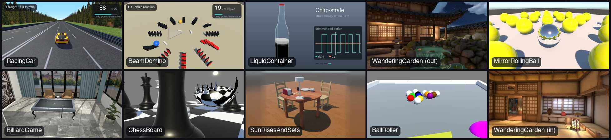
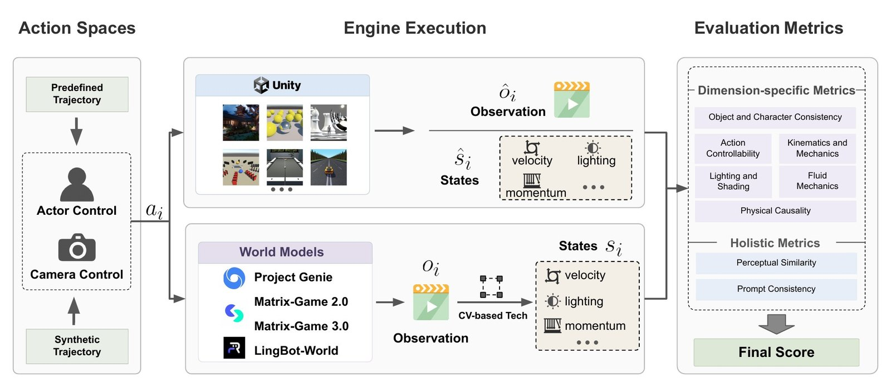

<p align="center">

</p>

<div align="center"> <h1>WMEval: Evaluating Interactive World Models Grounded on Physical Simulations</h1> </div>
<p align="center"> <b>📜 Paper</b> (coming soon) | <b>🌐 Project Page</b> (coming soon) | <b>🤗 Dataset</b> (coming soon)</p>

## Introduction

WMEval evaluates interactive world models against Unity-based physical simulations. Instead of judging generations on perceptual quality alone, it executes the **same action trajectory** in a Unity scene and in the world model, then compares the two rollouts using simulator-derived ground truth — camera poses, object states, masses, momentum and energy, causal event traces — as the reference. It consists of:

1. **9 Unity scenes** (`BallRoller` · `BeamDomino` · `BilliardGame` · `ChessBoard` · `LiquidContainer` · `MirrorRollingBall` · `RacingCar` · `SunRisesAndSets` · `WanderingGarden`), each paired with deliberately designed action trajectories.
2. **A Unity-free evaluation suite** (WMEval Lite): checksummed case bundles carrying the conditioning frame, prompt, action script, reference rollout and the Unity quantities each metric needs, plus one CLI that validates candidates, dispatches every dimension's evaluator and aggregates over seeds and cases.
3. **Standardized action trajectories** that compile one semantic trajectory onto each backend's native interface (Unity, Project Genie, Matrix-Game 2.0/3.0, LingBot-World), with explicit action targets, calibration and unsupported-control reporting.

<p align="center">
  <picture>
  
  </picture>
</p>

## Contents
- [Installation](#installation)
- [Quick Start](#quick-start)
- [WMEval Lite Suite](#wmeval-lite-suite)
  - [Case Bundles](#case-bundles)
  - [Outputs](#outputs)
- [Action Trajectories](#action-trajectories)
- [Evaluation Dimensions](#evaluation-dimensions)
  - [Case × Dimension Matrix](#case--dimension-matrix)
- [Additional Evaluators](#additional-evaluators)
- [Citation](#citation)

## Installation

1. Clone this repository:
```
git clone https://github.com/hao-ai-lab/WMEval.git
cd WMEval
```
2. Install dependencies (tested macOS arm64 lock shown; CUDA/Modal jobs use the pins in `tools/run_wmeval_lite_modal.py` and `requirements-gpu.lock`):
```
uv venv --python 3.11 .venv
uv pip install --python .venv/bin/python -r requirements-macos.lock
source .venv/bin/activate
```
3. Validate the bundled suite:
```
python tools/run_wmeval_lite.py validate --suite eval_sets/wmeval_lite_v1
```

VLM-judged dimensions (`prompt_scene_consistency`, `physical_causality`, causal `lpips`) need an `OPENAI_API_KEY`; CV-based dimensions download pinned checkpoints on first use (see `experiments/tables_4_7/evaluator_assets.lock.json`).

## Quick Start

Generate one video per case and seed from the case's conditioning frame, prompt and action script, place them at `<model_root>/<Scene>/<variant>/<seed>.mp4`, then run:

```
# What does the suite contain?
python tools/run_wmeval_lite.py list-cases --suite eval_sets/wmeval_lite_v1

# Evaluate every wired dimension (resumable; --dimensions selects a subset)
python tools/run_wmeval_lite.py run \
  --suite eval_sets/wmeval_lite_v1 \
  --model-root runs/<model> \
  --output-dir reports/wmeval_lite/<model> --resume
```

Instead of a directory tree you can pass a strict JSONL manifest with `--candidate-manifest`:

```json
{"model":"my_model","case_id":"BallRoller/ctrl","seed":"42","candidate_video":"/data/my_model/BallRoller/ctrl/42.mp4"}
{"model":"my_model","case_id":"RacingCar/prompt_first","seed":"42","candidate_video":"/data/other.mp4","params":{"shadow_hud_preset":"genie"}}
```

On Modal GPUs, `modal run tools/run_wmeval_lite_modal.py::main --model-root /cand/<model>` runs one container per candidate; `tools/generate_waypoint15_candidates_modal.py` is a worked example of generating a model's candidates straight from the bundles without Unity.

## WMEval Lite Suite

`eval_sets/wmeval_lite_v1/` is one suite with one CLI. `suite.yaml` declares the dimensions and is the single source of truth for case wiring; each case ships as a checksummed bundle under `cases/<Scene>/<variant>/`. The current release roster is **19 cases across 9 scenes, 8 dimensions and 31 case–dimension assignments**.

| Dimension | Question | Headline metrics |
| --- | --- | --- |
| [Environment Object & Character Consistency](#environment-object--character-consistency) | Do objects, spatial relations and character identity persist as the camera moves away and returns? | Depth AbsRel ↓, pairwise-distance MAE ↓ (against Unity-analytic geometry), object permanence ↑, DINOv2 character consistency ↑ |
| [Action Controllability](#action-controllability) | Does generated motion follow the commanded action or camera control? | Ground-Truth RAFT (relative EPE ↓, cosine ↑ vs. Unity flow); synthetic-flow cosine ↑ / pixel EPE ↓ vs. commanded motion |
| [Kinematics & Mechanics](#kinematics--mechanics) | Do matched controls produce simulator-consistent trajectories and mechanical outcomes? | DTW ↓, FDE ↓ (trajectories); momentum / kinetic-energy Error Rate ↓ and Exact Match ↑ |
| [Fluid Mechanics](#fluid-mechanics) | Does the liquid in a sealed, moving bottle slosh like the reference? | flow cosine (diagnostic), area jitter Δσ_A ↓ / drift ↓, surface angle ↓, slosh-spectrum L1 ↓, LPIPS ↓ |
| [Physical Causality](#physical-causality) | Does an action propagate through a multi-stage causal chain (rolling → impact → topple → cascade)? | Causal Success Rate ↑, AMCL/MCL, weighted score, DUA, ICRA — reported as deltas from the Unity reference judged the same way |
| [Lighting & Shading](#lighting--shading) | Do cast shadows stay geometrically and temporally coherent with one light source as the camera moves? | Scene Retention ↑, Shadow Detection ↑, Multi-Object Sun Disagreement ↓, Shadow Direction Jitter ↓, Shadow Area Stability ↓, Shadow Shape Drift ↓ |
| [Prompt-Scene Consistency](#prompt-scene-consistency) | Does the rollout match its scene description, for both environment and foreground objects? | Environment ↑, Object ↑, Overall ↑ rubric scores (ρ = 0.90 with human ratings) |
| [Perceptual Similarity (LPIPS)](#perceptual-similarity-lpips) | How perceptually close is the rollout to the reference around matched contact events? | Causal LPIPS ↓ (offsets −2…+2 around chronologically matched events), temporal LPIPS ↓ as a separate fallback |

### Case Bundles

```
eval_sets/wmeval_lite_v1/
  suite.yaml                       # dimension-level manifest (single source of truth)
  cases/<Scene>/<variant>/
    case.yaml                      # prompt, modules, protocol, evaluator_lock
    reference/
      reference.mp4                # reference video (reference-based dimensions)
      ref.png                      # conditioning frame where it differs from video frame 0
      checksums.sha256             # covers every file under reference/ (feeds the evaluator fingerprint)
      artifacts/
        actions.txt                # action script
        action.npy                 # numeric actions (+ intrinsics.npy / poses.npy / object_transforms.json)
        rubrics/<Scene>/<provider>_<model>_<version>.json   # committed judge rubrics
        qa_dataset.json / *.npz    # dimension-specific payloads (causal QA, liquid masks/flow)
```

Author or refresh a case with `python tools/build_lite_case.py <case_dir>` (writes checksums and the evaluator lock); generate prompt rubrics with `python tools/run_wmeval_lite.py generate-rubrics` (requires `OPENAI_API_KEY`). Legacy candidate ids are mapped through `legacy_case_aliases` in `suite.yaml`; convert old files with `tools/convert_legacy_candidates.py`.

### Outputs

`--output-dir` receives `per_case_results.jsonl` (one row per dimension × case × model × seed with status, flat metrics, the module's full report and the case's evaluator lock), `aggregate_summary.json` (two-level means — seeds within a case, then across cases — with `std_across_cases`, case means and per-case seed dispersion) and `aggregate_summary.csv` (headline mean and `_std` per dimension).

## Action Trajectories

Every case has an action script, but formats still differ by track:

- **Lite bundles** carry `actions.txt` (browser key programs or structured text) and, for most cases, a numeric `action.npy`; `python tools/audit_trajectory_readiness.py` reports which cases are native, supplemental or underspecified.
- **Table 4/7** uses canonical semantic trajectories (`experiments/tables_4_7/trajectories/*.yaml`, `schema_version: 1`) with typed channels, units, time segments and control rate, compiled by `python tools/prepare_table_trajectories.py` into `action.npy` / `action.npz` / Project Genie key programs with hashed manifests (`evaluation/trajectories.py`).
- **Backends** are declared once in `experiments/tables_4_7/action_backends.yaml` (read via `evaluation/action_backends.py`): what entity each trajectory actuates (`camera`, `ego_vehicle`, `cue_ball`, `table_objects`), each backend's native timeline, which targets it can express, why it cannot express the others, and the frozen response-side camera calibration. Input preparation refuses unsupported target/backend pairs instead of substituting another control.

| Backend | Native input | Camera trajectories | Vehicle / ball trajectories |
| --- | --- | --- | --- |
| Unity | runtime arguments | reference | reference |
| Project Genie | browser keys | nominal (left turn 51.47 °/s calibrated) | nominal key rules |
| Matrix-Game 2.0 | 129 frames @ 12 fps, keys + mouse | pooled 10.1 °/mouse unit/frame | thresholded WASD (target validation required) |
| Matrix-Game 3.0 | 177 frames @ 17 fps, keys + mouse | regime/direction-specific gains | out of scope |
| LingBot-World Base Cam | 161 camera poses @ 16 fps | nominal poses, no response correction | unsupported (camera input only) |

```
python tools/prepare_table_trajectories.py        # validate + compile semantic trajectories
python tools/prepare_matrix_game_inputs.py        # Matrix-Game 2.0 / 3.0 schedules + queues
python tools/prepare_lingbot_table7_inputs.py     # LingBot Base Cam poses/intrinsics + queue
```

## Evaluation Dimensions

Each dimension compares measurements recovered from the candidate video with quantities derived from Unity (reference-free dimensions say so). Expand **Full reference** for the complete pipeline, flags, outputs and interpretation notes of each evaluator.

### Environment Object & Character Consistency

Do objects, spatial relations and character identity persist as the camera moves away and returns?

- **Metrics:** Depth AbsRel ↓, pairwise-distance MAE ↓ (against Unity-analytic geometry), object permanence ↑, DINOv2 character consistency ↑
- **Suite dimension & tooling:** `environment_object_consistency` — GroundingDINO + SAM 2 tracking, metric depth, Unity poses/intrinsics/object transforms

<details>
<summary><b>Full reference</b> (formerly <code>README_environment_object_consistency.md</code>)</summary>

This document describes the `environment_object_consistency` registry module,
which implements the NeurIPS paper's appendix-B.1 metrics: GroundingDINO +
SAM 2 localize and track a fixed set of key objects (and the main character)
through a candidate rollout; a monocular depth model and DINOv2 turn those
tracks into four headline metrics.

##### Scope

This is a **reference-free-by-default** module: two of its four metrics
(`object_permanence_pct`, `character_consistency_pct`) only need the
candidate video. The other two (`depth_absrel_pct`,
`pairwise_distance_mae_pct`) additionally need Unity-side **analytical**
ground truth (per-object 3D world transforms + camera pose/intrinsics), per
the paper — not detector output re-run on Unity's own reference video.

As of this writing, no case bundle in `eval_sets/wmeval_lite_v1/` ships that
analytical ground-truth artifact (see `PENDING.md`), so
`depth_absrel_pct`/`pairwise_distance_mae_pct` currently report `null` with
`ground_truth_status: "pending"` until it lands.

##### Main Entry Points

- `evaluation/modules/environment_object_consistency.py`: core metric implementation
- `evaluation/registry.py` → `"environment_object_consistency"`: registry entry
- `tools/evaluate_world_model_metrics.py --modules environment_object_consistency`: generic CLI

##### Pipeline

1. GroundingDINO detects the configured key-object prompt
   (`eoc_text_prompt`, e.g. `"ball. chair. table."`) and character prompt
   (`eoc_character_prompt`, e.g. `"character. player."`) on frame 0.
2. SAM 2's video predictor tracks every detected box (objects + character)
   through the whole candidate video, giving per-frame masks/centroids.
3. GroundingDINO is **independently re-run on every frame** (not tied to the
   SAM 2 track IDs) to get a genuine per-frame detection confidence
   `s_{t,o}`, since SAM 2's video propagator does not expose one.
4. A monocular depth model (`eoc_depth_model`, default
   `depth-anything/Depth-Anything-V2-Small-hf` via `transformers`) samples
   depth at each tracked object's mask centroid; combined with the frame's
   pinhole intrinsics this back-projects centroids into candidate-side 3D
   points for pairwise distances.
5. DINOv2 (`torch.hub.load('facebookresearch/dinov2', 'dinov2_vits14')`)
   embeds the cropped character region every frame it is tracked, and its
   cosine similarity to the frame-0 embedding gates Character Consistency.

##### Metrics

| Metric | Formula | Ground truth needed |
| --- | --- | --- |
| `depth_absrel_pct` | `(1/\|O\|) * sum_o \|d_hat_o - d_o\| / (d_o + eps) * 100%` | Unity analytical (pending) |
| `pairwise_distance_mae_pct` | `(2/(\|O\|(\|O\|-1))) * sum_{i<j} \|delta_hat_ij - delta_ij\| / (delta_ij + eps) * 100%` | Unity analytical (pending) |
| `object_permanence_pct` | `(1/(T\|O\|)) * sum_t sum_o 1[s_{t,o} >= tau_det] * 100%` | none (candidate-only) |
| `character_consistency_pct` | `(1/T) * sum_t 1[s_t >= tau_det AND a_t >= tau_mask AND cos(phi_t, phi_1) >= tau_id] * 100%` | none (candidate-only) |

`d_o`/`delta_ij` (Unity depth and pairwise 3D distance) are computed
analytically from Unity's own known 3D object transforms and camera pose,
not by re-running detectors on Unity's reference video — see "Ground truth
artifacts" below.

Notes on two formula-vs-implementation choices, documented here rather than
silently baked in:

- The paper's Depth-AbsRel / Pairwise-Distance formulas sum only over
  objects, with no explicit sum over frames `t` (unlike Object Permanence /
  Character Consistency, which are explicit sums over `t`). This
  implementation time-averages `d_hat_o`/`delta_hat_ij` and
  `d_o`/`delta_ij` over the frames each side has data for, then applies the
  formula once on the averages. If the intent was per-frame AbsRel then
  averaged over time, flag it and this will change.
- `a_t` ("mask quality/stability score") is approximated as the tracked
  character mask's area ratio to its frame-0 area, clipped to `[0, 1]`, since
  SAM 2's video predictor does not directly expose a mask-quality score.

##### Ground truth artifacts

Configure via `metric_config`/`module_params` (see `METRIC_CONFIG_KEYS` in
`evaluation/lite/adapters/registry_adapter.py`) or the matching
`run_world_model_evaluation(...)` kwargs:

- `eoc_unity_object_transforms_json`: JSON, schema:
  ```json
  {
    "objects": {
      "<label>": {
        "frames": [0, 1, 2],
        "positions_world": [[x, y, z], [x, y, z], [x, y, z]]
      }
    }
  }
  ```
  `<label>` must match (case-insensitively) the noun phrases GroundingDINO
  is asked to detect, so candidate detections and Unity ground truth pair up.
- `eoc_unity_poses_npy`: `(T, 4, 4)` camera-to-world matrices — same
  convention as the `poses.npy` artifact already bundled in e.g.
  `eval_sets/wmeval_lite_v1/cases/BallRoller/ctrl/reference/artifacts/poses.npy`.
- `eoc_unity_intrinsics_npy`: `(T, 4)` `[fx, fy, cx, cy]` per frame — same
  convention as the bundled `intrinsics.npy`.

Without `eoc_unity_object_transforms_json` and `eoc_unity_poses_npy`, the
module still reports `object_permanence_pct`/`character_consistency_pct`
and sets `ground_truth_status: "pending"` with `depth_absrel_pct` /
`pairwise_distance_mae_pct` as `null`.

##### Useful Flags

- `--eoc_text_prompt "ball . rack . ramp ."` — GroundingDINO key-object prompt
- `--eoc_character_prompt "player character ."` — GroundingDINO character prompt
- `--eoc_tau_det 0.30` — detection-confidence threshold
- `--eoc_tau_mask 0.50` — mask-quality/stability threshold
- `--eoc_tau_id 0.50` — DINOv2 identity-cosine threshold
- `--eoc_max_objects 6` — cap on tracked key objects
- `--eoc_depth_model depth-anything/Depth-Anything-V2-Small-hf`

##### Dependencies

`torch`, `transformers` (GroundingDINO zero-shot detection + depth
estimation), `sam2` (video predictor) — all already required by
`shadow_consistency`. DINOv2 is fetched at runtime via `torch.hub` (needs
network access to github.com on first run; no extra pip package).

##### Interpretation Notes

- `object_permanence_pct`/`character_consistency_pct` measure candidate
  self-consistency; they say nothing about whether the candidate matches
  Unity's actual object/character behavior.
- Until `eoc_unity_object_transforms_json` lands for a case,
  `ground_truth_status` will read `"pending"` in every report for that case
  — this is expected, not a bug.

</details>

### Action Controllability

Does generated motion follow the commanded action or camera control?

- **Metrics:** Ground-Truth RAFT (relative EPE ↓, cosine ↑ vs. Unity flow); synthetic-flow cosine ↑ / pixel EPE ↓ vs. commanded motion
- **Suite dimension & tooling:** `action_controllability` — `control_motion` module, `tools/evaluate_world_model_controllability.py`

<details>
<summary><b>Full reference</b> (formerly <code>README_controllability_eval.md</code>)</summary>

This document describes the RAFT controllability path in `WMEval`, plus an optional
**synthetic reference flow** branch compatible with the synthetic mode in
[ptlflow `eval_flow_divergence.py`](https://github.com/shaoxiongduan/ptlflow/blob/main/eval_flow_divergence.py).

##### Scope

This v1 implementation is intentionally video-only on the Unity side:

- `--ref_video`: Unity reference video
- `--video`: world-model / generated video

The module estimates optical flow from both videos with RAFT, then compares the
resulting motion fields. It does **not** require `GroundingDINO`, `ByteTrack`,
or Unity-exported dense flow artifacts in v1.

##### Main Entry Points

- `tools/evaluate_world_model_controllability.py`: dedicated controllability CLI
- `tools/evaluate_world_model_metrics.py --modules control_motion`: generic CLI
- `evaluation/modules/control_motion.py`: core metric implementation

##### What The Metric Measures

For each aligned frame pair:

1. Estimate RAFT flow on the Unity reference video.
2. Estimate RAFT flow on the world-model video.
3. Compare the two motion fields.

This is still an estimated-vs-estimated comparison, not true Unity dense-flow
ground truth. It is therefore a controllability-oriented proxy rather than a
final benchmark definition.

##### Reported Metrics

The `control_motion` module reports:

- raw frame-space comparison
- optional camera-compensated comparison
- mean / median / p90 / max EPE
- dynamic-region EPE
- dynamic-region angular error
- dynamic-region cosine similarity
- dynamic-region relative EPE
- adaptive dynamic-motion thresholds used for masking
- bad-pixel rates at configurable EPE thresholds
- per-pair camera-motion models for the reference and candidate videos

###### Endpoint Error (EPE)

If the reference flow vector at a pixel is `(u_ref, v_ref)` and the candidate
flow vector is `(u_cand, v_cand)`, then:

```text
EPE = sqrt((u_cand - u_ref)^2 + (v_cand - v_ref)^2)
```

Lower EPE means the candidate motion is closer to the Unity reference motion.

###### Bad-Pixel Rate

For a chosen threshold `t`, this is the fraction of pixels whose EPE is larger
than `t`. The default thresholds are `1.0` and `3.0` pixels.

###### Dynamic Mask

Dynamic-region metrics use a mask derived from the reference-flow magnitude:

- default threshold: `0.5` pixels
- default adaptive percentile: `75`
- the effective threshold is `max(abs_threshold, percentile_threshold)`
- pixels below that threshold are treated as effectively static

##### Camera Compensation

Camera drift can dominate dense flow even when the target object behavior is
reasonable. To expose that effect, `control_motion` can also compute a
camera-compensated comparison.

Current v1 strategy:

- estimate camera motion per frame pair from each flow field
- default estimator: `median_translation`
- optional `affine_ransac` mode is available for experimentation
- fall back to translation when affine fitting fails
- subtract the estimated camera-motion field from the corresponding flow field
- recompute EPE / angular error / cosine similarity / bad-pixel rates on the residual flow

This is a lightweight approximation of camera-motion compensation. It is useful
for inspection, but it is not a substitute for object-centric or true
world-frame trajectory analysis.

##### Quick Start

```bash
python tools/evaluate_world_model_controllability.py \
  --ref_video /abs/path/unity.mp4 \
  --video /abs/path/world_model.mp4 \
  --output_json reports/world_model_controllability/report.json \
  --eval_fps 4 \
  --max_pairs 32
```

Equivalent generic runner usage:

```bash
python tools/evaluate_world_model_metrics.py \
  --ref_video /abs/path/unity.mp4 \
  --video /abs/path/world_model.mp4 \
  --modules control_motion \
  --output_json reports/world_model_controllability/report.json
```

##### Useful Flags

- `--control_global_motion_mode affine_ransac|median_translation|mean_translation`
- `--control_motion_mask_threshold 0.5`
- `--control_motion_mask_percentile 75`
- `--control_bad_pixel_thresholds 1.0,3.0`
- `--disable_control_camera_compensation`

##### Interpretation Notes

- Lower `raw.epe_summary.mean` means the world-model motion is closer to the
  Unity reference motion in image space.
- Lower `camera_compensated.epe_summary.mean` suggests the mismatch was partly
  due to global camera drift rather than object-relative motion.
- Higher `camera_compensated.cosine_similarity_dynamic_summary.mean` means the
  candidate motion direction is more aligned with the reference after removing
  estimated camera motion.
- Large gaps between raw and compensated scores are a signal to inspect camera
  motion and framing before drawing strong conclusions about controllability.

##### Synthetic flow vs RAFT (action-conditioned proxy)

When you pass a calibration file and either an action recording or **inferred**
actions, `control_motion` additionally reports `synthetic_vs_candidate`:

- **Reference motion**: Longuet-Higgins field from `synthetic_flow.py` (loaded
  from your `ptlflow` checkout: default auto-resolution prefers sibling
  `../ptlflow`, then falls back to `--ptlflow_root` or `/workspace/ptlflow`).
- **Candidate motion**: **same RAFT model** as the main block (consistent with
  the RAFT ref vs RAFT gen comparison).
- **Per-pair / temporal metrics**: same families as ptlflow (`mf_epe`, `pixel_epe_mean`,
  `flow_kl_2d`, FOE distance, `fl_all`, divergence onset, etc.) via
  `evaluation/modules/flow_divergence_metrics.py`.

###### CLI flags

- `--synthetic_calibration /path/to/calibration.json` — required to enable the block
- `--synthetic_action_file /path/to/actions.npy` — dict with `keyboard` `(T,6)` and
  `mouse` `(T,2)`; rows indexed by sampled candidate frame indices
- `--synthetic_infer_actions` — if no npy is available, fit continuous
  keyboard+mouse so synthetic flow matches **RAFT on the Unity reference** for
  each sampled pair (approximate; slower).
- `--synthetic_use_depth` — translation term uses Depth Anything (optional;
  needs `transformers` + download).
- `--synthetic_grid_size` — grid EPE binning (default 8).

Example:

```bash
python tools/evaluate_world_model_controllability.py \
  --ref_video /abs/unity.mp4 \
  --video /abs/world_model.mp4 \
  --synthetic_calibration /abs/ptlflow/calibration.json \
  --synthetic_infer_actions \
  --output_json reports/world_model_controllability/report_synth.json
```

##### Future Extensions

Likely follow-ups after this v1:

- Unity-exported dense flow ground truth
- explicit camera trajectory artifacts
- object-centric controllability regions
- trajectory matching in a stabilized reference frame

</details>

### Kinematics & Mechanics

Do matched controls produce simulator-consistent trajectories and mechanical outcomes?

- **Metrics:** DTW ↓, FDE ↓ (trajectories); momentum / kinetic-energy Error Rate ↓ and Exact Match ↑
- **Suite dimension & tooling:** `kinematics_mechanics` — detection + tracking lifted with Unity camera calibration, masses and diameters

<details>
<summary><b>Full reference</b> (formerly <code>README_kinematics_mechanics.md</code>)</summary>

This document describes the `kinematics_mechanics` registry module, which
reconstructs key-object trajectories from an action-conditioned candidate
rollout with GroundingDINO + ByteTrack, and compares them against Unity-side
references (trajectory fidelity, momentum, kinetic energy) per the NeurIPS
paper's appendix B.3.

##### Scope

Like `environment_object_consistency` (B.1), this module is candidate-only
by default: it always reports the reconstructed candidate trajectories
(`trajectories`), useful for QA even without ground truth. Ground-truth
comparison (`trajectory_fidelity`, `mechanical_quantities`) additionally
needs Unity-side artifacts described below.

**Honesty note on what "trajectory fidelity" currently means here:** the
paper's B.3 FDE/DTW are 3D metrics. This module's candidate-side pipeline is
monocular (GroundingDINO + ByteTrack on 2D pixel boxes); without a
per-frame *candidate* camera-pose artifact there is no way to lift that into
a metric 3D trajectory. So when ground truth is available,
`trajectory_fidelity` reports a **2D pixel-space reprojection proxy**:
the candidate's raw pixel trajectory vs. Unity's 3D ground-truth trajectory
reprojected through Unity's *own* ground-truth camera (`status:
"reprojection_proxy_2d"`), not the paper's 3D FDE/DTW. Likewise
`mechanical_quantities` can report mass and a pixel/frame terminal speed
(`status: "pixel_units_only"`) but not momentum/kinetic energy in physical
units, since that also needs metric-scale candidate velocity. See
`eval_sets/wmeval_lite_v1/PENDING.md` for what would close this gap
(candidate-side pose recovery or a metric-depth model).

##### Main Entry Points

- `evaluation/modules/kinematics_mechanics.py`: core metric implementation
- `evaluation/registry.py` → `"kinematics_mechanics"`: registry entry
- `tools/evaluate_world_model_metrics.py --modules kinematics_mechanics`: generic CLI
- `tools/groundingdino_bytetrack.py`: the standalone GroundingDINO+ByteTrack
  visualization script this module's detection/tracking step mirrors
  (see [GroundingDINO tracking](#groundingdino-tracking))

##### Pipeline

1. GroundingDINO detects the configured key-object prompt (`kin_text_prompt`)
   independently on every frame of the candidate video.
2. A ByteTrack tracker (`cjm_byte_track.core.BYTETracker`, falling back to
   `bytetracker.BYTETracker`) associates per-frame detections into tracks;
   short tracks (`kin_min_track_len`) are dropped, and each surviving track
   is assigned the majority-vote label across its detections.
3. Objects listed in `kin_static_anchor_labels` (comma-separated) are
   treated as static scene anchors: their mean per-frame centroid shift
   (relative to frame 0) is used as a camera-ego-motion estimate, subtracted
   from every tracked centroid to produce `centroid_uv_compensated` — an
   approximate common static reference frame, in the spirit of the paper's
   "track static anchors to estimate moving reference-frame motion."
4. When ground truth is configured, Unity's 3D trajectory for a matching
   label is reprojected through Unity's own camera
   (`kin_unity_poses_npy`/`kin_unity_intrinsics_npy`) and compared against
   the candidate's **raw** (uncompensated) pixel trajectory with FDE and DTW
   (see the honesty note above for why raw, not compensated, is used here).

##### Metrics

| Metric | Formula | Status in this module |
| --- | --- | --- |
| FDE | `\|\| x_hat_T - x_T \|\|_2` | 2D pixel-space proxy (`trajectory_fidelity[label].fde_px`) |
| DTW | `min_pi sum_(i,j) in pi \|\| x_hat_i - x_j \|\|_2` | 2D pixel-space proxy (`trajectory_fidelity[label].dtw_px`) |
| Momentum `p_hat_t = m * v_hat_t` | -- | pending metric-scale velocity |
| Kinetic energy `E_hat_t = 0.5 * m * \|\|v_hat_t\|\|^2` | -- | pending metric-scale velocity |
| ExactMatch / ErrorRate over `p`/`E` | `round2(q_hat_o) == round2(q_o)` / `\|q_hat_o - q_o\| / (\|q_o\| + eps)` | not yet computed (needs the above) |

##### Ground truth artifacts

- `kin_unity_object_transforms_json`: same schema as
  `eoc_unity_object_transforms_json` (see
  [Environment Object & Character Consistency](#environment-object--character-consistency)) — per-frame per-object 3D
  world positions.
- `kin_unity_poses_npy` / `kin_unity_intrinsics_npy`: `(T, 4, 4)` /
  `(T, 4)`, same convention as the bundled `poses.npy`/`intrinsics.npy`
  (e.g. `eval_sets/wmeval_lite_v1/cases/BallRoller/ctrl/reference/artifacts/`).
- `kin_unity_object_masses_json`: flat `{"<label>": mass_kg}` dict.

Without `kin_unity_object_transforms_json` + poses + intrinsics, the module
reports `ground_truth_status: "pending"` and leaves `trajectory_fidelity` /
`mechanical_quantities` as `null`, still returning the reconstructed
candidate `trajectories` for inspection.

##### Useful Flags

- `--kin_text_prompt "ball . car . pin ."` — GroundingDINO key-object prompt
- `--kin_static_anchor_labels "wall,floor"` — comma-separated static-anchor labels for camera-motion estimation
- `--kin_track_thresh 0.5 --kin_track_buffer 30 --kin_match_thresh 0.8` — ByteTrack knobs
- `--kin_min_track_len 4` — minimum detections for a track to count as a trajectory

##### Dependencies

`torch`, `transformers` (GroundingDINO zero-shot detection, same HF path as
`shadow_consistency`), and a ByteTrack implementation:

```bash
pip install cjm-byte-track   # matches tools/groundingdino_bytetrack.py
# or, if unavailable:
pip install bytetracker
```

##### Interpretation Notes

- `camera_compensation_applied` is `false` whenever `kin_static_anchor_labels`
  is empty or no anchor was detected in any frame — check this before
  trusting `centroid_uv_compensated`.
- Treat `trajectory_fidelity`/`mechanical_quantities` `status` fields as
  load-bearing: `"reprojection_proxy_2d"` and `"pixel_units_only"` are not
  the paper's final metrics, only diagnostics until candidate-side pose
  recovery exists.

</details>

### Fluid Mechanics

Does the liquid in a sealed, moving bottle slosh like the reference?

- **Metrics:** flow cosine (diagnostic), area jitter Δσ_A ↓ / drift ↓, surface angle ↓, slosh-spectrum L1 ↓, LPIPS ↓
- **Suite dimension & tooling:** `fluid_mechanics` — SAM 2 liquid mask, RAFT/OpenPIV; `tools/evaluate_world_model_liquid.py`

<details>
<summary><b>Full reference</b> (formerly <code>README_liquid_eval.md</code>)</summary>

This document explains how to run the LiquidContainer (sealed-bottle
sloshing) evaluation in the current `WMEval` framework end-to-end: from a
Unity reference recording and a world-model candidate video through SAM2
liquid/bottle masking, RAFT velocity fields, the four sloshing modules
(plus the cross-cutting perceptual modules), and finally the per-model
JSON report and pooled leaderboard CSV.

The module set treats the bottle as a **sealed half-filled container**
under fixed-camera (regime `c2_static_side`) playback, so failures are
*continuous* — volume drift, surface-tilt residual, off-frequency slosh —
rather than discrete event errors. Every metric is reported as a `{unity,
wm, delta}` block with the convention **positive delta = WM is worse than
Unity** (`delta = wm − unity`).

##### 1) Pipeline overview

The pipeline is a stack of shell wrappers around one Python entry point.
All four sloshing modules share the same SAM2 + RAFT cache, so a
manifest run pays mask/flow cost only once per video:

```
scripts/normalize_fps.sh                  (sourced helper, not run alone)
    in:  REF_VIDEO, WM_VIDEO              (any resolution / fps)
    out: 832x464 @ 16 fps mp4s            (WMEval LiquidContainer canonical)

scripts/evaluate_world_model_liquid_full.sh
    in:  REF_VIDEO, WM_VIDEO, OUT_JSON [, WM_NAME]
    out: per-pair report.json             (4 sloshing modules + lpips + control_motion + clip4clip)

scripts/run_liquid_leaderboard.sh
    in:  MANIFEST_TSV, OUT_DIR [, REF_VIDEO_DEFAULT]
    out: <OUT_DIR>/<model>.json (one per row) + leaderboard.csv

scripts/sanity_unity_vs_unity_liquid.sh
    in:  REF_VIDEO [CAND_VIDEO] [OUT]
    out: identity.json                    (the noise floor; read deltas RELATIVE to this)
```

The Python entry point under those wrappers is
[tools/evaluate_world_model_liquid.py](tools/evaluate_world_model_liquid.py),
which thinly wraps `evaluation.runner.run_world_model_evaluation` with
the `--liquid_*` argument namespace. The Unity recording side (running
the LiquidContainer scene to produce `Unity_<profile>.mp4`) lives in
`WorldModelBenchScenePrivate/GameScenes/LiquidContainer/`. This README
is scoped to everything that happens once you have a Unity reference
mp4 and a world-model candidate mp4 on disk.

##### 2) Scope

- Main entry: [tools/evaluate_world_model_liquid.py](tools/evaluate_world_model_liquid.py)
- Wrappers:
  - [scripts/evaluate_world_model_liquid_full.sh](scripts/evaluate_world_model_liquid_full.sh) — single (REF, WM) pair, full headline set.
  - [scripts/run_liquid_leaderboard.sh](scripts/run_liquid_leaderboard.sh) — fleet of WMs from a TSV manifest → CSV.
  - [scripts/sanity_unity_vs_unity_liquid.sh](scripts/sanity_unity_vs_unity_liquid.sh) — Unity-vs-Unity noise floor.
- Mask debugging: [tools/liquid_mask_qa.py](tools/liquid_mask_qa.py) — render SAM2 liquid + bottle overlays at first / mid / last frame to verify the prompt before paying for a full eval.
- Report inspection: [tools/inspect_liquid_report.py](tools/inspect_liquid_report.py) — pretty-print one or many reports with sanity flags.
- The four sloshing modules registered in [evaluation/registry.py](evaluation/registry.py):
  - `liquid_velocity` — RAFT (default) or OpenPIV flow inside the liquid mask.
  - `liquid_volume_conservation` — projected mask area jitter + drift.
  - `liquid_surface_orientation` — air/liquid interface tilt RMS.
  - `slosh_spectrum` — meniscus FFT, dominant frequency + spectral L1.
- Cross-cutting (used by the leaderboard wrapper, optional otherwise):
  `lpips`, `control_motion`, `clip4clip`.

##### 3) Environment

The four sloshing modules require:

- **SAM2** (`facebook/sam2.1-hiera-small` by default), pulled lazily by
  [evaluation/modules/_liquid_common.py](evaluation/modules/_liquid_common.py)
  on first use; needs HF cache + GPU.
- **GroundingDINO** to seed SAM2's first-frame box from the text prompt
  (`"the liquid inside the bottle"` / `"the glass bottle"`).
- **RAFT** (default) or **OpenPIV** for in-mask velocity estimation.
- **ffmpeg / ffprobe** on `PATH` for `normalize_fps`.
- `opencv-python`, `numpy`, `scipy`, `torch` in the WMEval venv.

Create / activate the WMEval venv (do **not** reuse the Unity `mlagents`
env — its pinned `numpy` / `protobuf` versions fight `opencv-python` /
`torch`):

```bash
cd WMEval_code/WMEval
python -m venv .venv
source .venv/bin/activate
pip install -r requirements.txt   # if present, otherwise install the imports above
```

If you plan to enable `lpips` (it is on in the full wrapper), the VLM
judge instructions are scoped via `--lpips_vlm_scene_key liquid_container`
so the prompt knows it's looking at a sloshing bottle.

##### 4) Canonical resolution / fps

LiquidContainer canonical is **832×464 @ 16 fps** — lingbot's native
output (the constrained side). Unity (1280×720 @ 30 fps) and any other
WM recording are downsampled to match before the eval runs.

[scripts/normalize_fps.sh](scripts/normalize_fps.sh) provides
`normalize_video` (used by both `evaluate_world_model_liquid_full.sh` and
`sanity_unity_vs_unity_liquid.sh`). Override via env vars:

```bash
WMEVAL_CANONICAL_FPS=16 WMEVAL_CANONICAL_W=832 WMEVAL_CANONICAL_H=464 \
  bash scripts/evaluate_world_model_liquid_full.sh ref.mp4 wm.mp4 out.json
```

Without normalization:
- PIV / RAFT grid shapes differ across WMs, so EPE / cosine break.
- An fps mismatch silently scales pixel velocities and FFT frequencies
  by `ref_fps / wm_fps`. `_liquid_common.require_matched_fps` raises
  rather than letting that scale through, but only when both sides
  reach the modules — normalize first to avoid the late failure.

##### 5) Step 1 — Mask QA (cheap, do this first on any new video set)

`liquid_mask_qa.py` runs SAM2 with both the liquid prompt and the bottle
prompt and writes overlay PNGs at first / middle / last frame. A wrong
mask poisons all four sloshing metrics silently — always eyeball this on
at least one trajectory per WM before paying for a full leaderboard.

```bash
python tools/liquid_mask_qa.py \
  --videos /path/to/wm_pred.mp4 \
  --out reports/liquid_qa/wm_pred \
  --liquid-prompt "the liquid inside the bottle" \
  --bottle-prompt "the glass bottle"
```

Inspect `reports/liquid_qa/wm_pred/summary_strip.png`. The cyan overlay
should hug the liquid only (not the glass walls); the blue overlay
should match the full bottle silhouette. If either is wrong, reword the
prompt and rerun (cache is keyed on prompt content).

##### 6) Step 2 — Noise-floor sanity (Unity vs Unity)

Before reading any WM number, run the floor finder. The deltas it
produces are the irreducible Unity-vs-Unity noise (render seed,
stochastic shader state, RAFT non-determinism); every WM-vs-Unity number
should be read **relative to this**, not against zero.

```bash
# self-pair: same clip on both sides; deltas should be ~0.
bash scripts/sanity_unity_vs_unity_liquid.sh

# cross-pair: two seeds of the same Unity scene.
bash scripts/sanity_unity_vs_unity_liquid.sh \
  unity/LiquidContainer/Recordings/Movie_001.mp4 \
  unity/LiquidContainer/Recordings/Movie_002.mp4 \
  reports/world_model_liquid_sanity/cross_pair.json
```

The expected ranges for each metric on a self-pair vs cross-pair are
documented in the script header. If self-pair deltas are not near zero,
something upstream is broken — fix that before trusting WM deltas.

##### 7) Step 3 — Single-pair eval

The "full" wrapper runs all four sloshing modules plus the cross-cutting
perceptual modules and tags the report with the model name:

```bash
bash scripts/evaluate_world_model_liquid_full.sh \
  unity/LiquidContainer/Recordings/Unity_step_hold.mp4 \
  outputs/lingbot/.../step_hold-.../video.mp4 \
  reports/liquid/lingbot_step_hold.json \
  lingbot_run1_step_hold
```

Equivalent direct invocation (skips fps normalization — be sure both
videos are already at canonical 832×464 @ 16 fps):

```bash
python tools/evaluate_world_model_liquid.py \
  --video         outputs/.../video_norm.mp4 \
  --ref_video     unity/.../Unity_step_hold_norm.mp4 \
  --modules       liquid_velocity,liquid_volume_conservation,liquid_surface_orientation,slosh_spectrum \
  --liquid_cache_root  runs/liquid_cache \
  --liquid_sam2_model  facebook/sam2.1-hiera-small \
  --liquid_sam2_prompt "the liquid inside the bottle" \
  --liquid_bottle_prompt "the glass bottle" \
  --liquid_flow_estimator raft \
  --liquid_camera_compensation \
  --liquid_camera_regime c2_static_side \
  --output_json   reports/liquid/lingbot_step_hold.json \
  --eval_fps 4 --max_pairs 512 --liquid_max_pairs 0
```

Inspect:

```bash
python tools/inspect_liquid_report.py reports/liquid/lingbot_step_hold.json
```

##### 8) Step 4 — Build a manifest

The leaderboard wrapper iterates a TAB-separated manifest, one WM per
line. Lines starting with `#` and blank lines are skipped. CRLF-encoded
manifests are tolerated.

| Column | Meaning |
| --- | --- |
| 1 | `model_name` — used as filename for the per-model JSON, must be unique. |
| 2 | `candidate_video_path` — the WM mp4. |
| 3 (optional) | `ref_video_override` — Unity reference for THIS row. Required when different rows pair against different references (e.g. one ref per action profile). |

Example (excerpt of [manifests/liquid_full_grid.tsv](manifests/liquid_full_grid.tsv)):

```tsv
lingbot_run1_step_hold	/path/to/wm_step_hold.mp4	/path/to/Unity_step_hold.mp4
matrix_game2_run1_rest	/path/to/wm_rest.mp4	/path/to/Unity_rest.mp4
```

Pre-built manifests:
- [manifests/liquid_full_grid.tsv](manifests/liquid_full_grid.tsv) — 64 rows: lingbot run1-6 + matrix-game2 run1-5 + matrix-game3 run1-5 × 4 action profiles.
- [manifests/lingbot_liquid_grid.tsv](manifests/lingbot_liquid_grid.tsv) — lingbot subset.
- [manifests/matrix_games_liquid_grid.tsv](manifests/matrix_games_liquid_grid.tsv) — matrix-game subset.

##### 9) Step 5 — Leaderboard run

```bash
bash scripts/run_liquid_leaderboard.sh \
  manifests/liquid_full_grid.tsv \
  reports/world_model_liquid_full
```

Outputs:

```
reports/world_model_liquid_full/
  <model>.json          # one per row (full per-module report; tagged with "model")
  leaderboard.csv       # five-pillar headline table, one row per model
```

Per-row failures are caught: the row is logged to stderr and the rest of
the manifest still runs. The summary at the end lists failed rows.

The CSV columns (driven by the wrapper's `COLUMNS` list) are
deliberately the **headline** set:

```
model,
liquid_velocity.cosine_similarity,
liquid_volume_conservation.mask_area_std_normalized.delta,
liquid_volume_conservation.mask_area_drift_per_sec.delta,
liquid_surface_orientation.surface_tilt_residual_deg.delta,
slosh_spectrum.meniscus.spectral_l1,
slosh_spectrum.meniscus.dominant_frequency_hz.delta_hz,
lpips.lpips_mean
```

EPE / divergence_residual / curl are intentionally absent from the CSV:
on opaque uniform liquids RAFT magnitudes are dominated by hallucinated
flow, so those numbers track estimator noise rather than physics. They
remain in each per-model JSON for identity-pair sanity checks.

##### 10) Caches

All SAM2 masks (liquid + bottle), bottle centroid traces, and PIV / RAFT
fields are pickled under:

```
runs/liquid_cache/
  <video_basename>__<content_hash>__<kind>__<config_hash>.pkl
```

The cache key includes the video's content hash and a per-kind config
hash (only the keys that affect each output are hashed — changing PIV
window size does not invalidate SAM2 masks). To force a recompute, delete
the matching pickle. Sharing the same `--liquid_cache_root` across
trajectories is intentional: each video is masked once across all four
modules and across re-runs.

##### 11) Output fields and interpretation

A per-pair report.json has the shape:

```json
{
  "model": "lingbot_run1_step_hold",
  "results": {
    "liquid_velocity": {
      "epe": { "mean": ..., "median": ..., "p90": ... },
      "cosine_similarity": ...,
      "divergence_residual": ...,
      "curl_stats": { "mean_error": ..., "std_error": ... },
      "temporal_consistency": ...,
      "diagnostics": {
        "flow_estimator": "raft",
        "piv_validity_unity": ..., "piv_validity_wm": ...,
        "liquid_mask_unity": { "mean_area_frac": ... },
        "liquid_mask_wm":    { "mean_area_frac": ... },
        "bottle_compensation": true
      }
    },
    "liquid_volume_conservation": {
      "mask_area_std_normalized": { "unity": ..., "wm": ..., "delta": ... },
      "mask_area_drift_per_sec":  { "unity": ..., "wm": ..., "delta": ... },
      "diagnostics": { "frames_evaluated": N }
    },
    "liquid_surface_orientation": {
      "surface_tilt_residual_deg": { "unity": ..., "wm": ..., "delta": ... }
    },
    "slosh_spectrum": {
      "meniscus":  { "dominant_frequency_hz": { "unity": ..., "wm": ..., "ratio": ..., "delta_hz": ... },
                     "spectral_l1": ... },
      "centroid":  { ... same shape ... }
    },
    "lpips": { "lpips_mean": ..., ... },
    "control_motion": { ... },
    "clip4clip":      { ... }
  }
}
```

###### Metric reference

For every `delta` field below, **positive = WM worse than Unity**.

- `liquid_velocity.cosine_similarity` — best at `1` (worst at `-1`).
  EPE / divergence_residual / curl_stats / temporal_consistency are kept
  in the JSON for identity-pair sanity but are **not** the headline
  numbers — see §9.
- `liquid_volume_conservation.mask_area_std_normalized.delta` — short-
  horizon mask flicker; ideal `0`.
- `liquid_volume_conservation.mask_area_drift_per_sec.delta` — long-
  horizon leakage / spurious growth (1/sec); ideal `0`. A sealed bottle
  with a fixed camera should have area exactly conserved up to AA noise.
- `liquid_surface_orientation.surface_tilt_residual_deg.delta` — extra
  RMS tilt (degrees) of the air/liquid interface beyond Unity's. For an
  upright bottle Unity is ~0; a WM that tilts the surface gets penalised.
- `slosh_spectrum.meniscus.spectral_l1` — L1 distance between unit-area
  power spectra (catches mode-shape mismatch even when the peak frequency
  is right). Ideal `0`.
- `slosh_spectrum.meniscus.dominant_frequency_hz.delta_hz` — peak-
  frequency offset in Hz. Ideal `0`.

The `meniscus` block is preferred over `centroid` because the centroid
is contaminated by camera-induced bottle motion already absorbed by
volume / orientation.

##### 12) Typical iteration loop

1. Record one Unity reference per action profile from
   `WorldModelBenchScenePrivate/GameScenes/LiquidContainer/` →
   `unity/LiquidContainer/Recordings/Unity_<profile>.mp4`.
2. Generate WM rollouts conditioned on the same first frame / actions →
   `outputs/<wm>/LiquidContainer/<run>/<profile>-<ts>/video.mp4`.
3. Eyeball masks for one trajectory per WM:
   ```bash
   python tools/liquid_mask_qa.py --videos outputs/.../video.mp4 --out reports/liquid_qa/<wm>
   ```
4. Build / extend the manifest:
   ```bash
   echo -e "<wm>_<run>_<profile>\t<wm_path>\t<unity_path>" >> manifests/liquid_full_grid.tsv
   ```
5. Run the leaderboard:
   ```bash
   bash scripts/run_liquid_leaderboard.sh manifests/liquid_full_grid.tsv reports/world_model_liquid_full
   ```
6. Inspect:
   ```bash
   python tools/inspect_liquid_report.py reports/world_model_liquid_full/<wm>.json
   column -t -s, reports/world_model_liquid_full/leaderboard.csv | less -S
   ```

##### 13) Camera regimes

The shipped wrappers assume `c2_static_side` — fixed camera, bottle
stationary in world. Camera bulk motion is then negligible, and
`--liquid_camera_compensation` (on by default) subtracts the SAM2 bottle
centroid delta from the velocity field to absorb residual rendering
jitter. For other regimes (e.g. `c1_handheld`):

- Bottle centroid will drift across the frame — bulk-motion compensation
  becomes load-bearing instead of cosmetic. Confirm bottle masks are
  clean before trusting velocity numbers.
- The slosh-spectrum centroid trace should not be used (camera motion
  dominates); the `meniscus` trace is camera-compensated by tracking the
  bottle's own y-coordinate. Stick to the `meniscus` headline number.
- `liquid_volume_conservation` still works but interpret short-horizon
  jitter relative to the camera-only sanity floor for that regime.

Pass `--liquid_camera_regime c1_handheld` to tag the report; nothing else
in the modules currently branches on it (the field is informational), but
downstream analysis can filter on it.

##### 14) RAFT vs OpenPIV

`--liquid_flow_estimator raft` (default) uses learned dense optical flow;
works on opaque / uniform fluids where the texture-free interior would
otherwise return NaN under cross-correlation. `--liquid_flow_estimator
openpiv` uses cross-correlation; only meaningful when the liquid has rich
internal texture (e.g. milky / particulate fluids). On the WMEval
LiquidContainer scene the default is RAFT.

If you switch estimators, also drop the cached PIV pickles for the
affected videos — the cache is keyed on (window_size, overlap), not on
estimator identity.

##### 15) Troubleshooting

| Symptom | Cause / fix |
| --- | --- |
| `ValueError: liquid_*: reference fps != candidate fps` | One side wasn't run through `normalize_fps`. Use the wrappers in `scripts/`, or set `WMEVAL_CANONICAL_FPS` consistently. |
| `flow validity wm = X% vs mask coverage Y% (ratio < 0.5)` from `inspect_liquid_report.py` | RAFT/PIV is rejecting cells INSIDE the mask. With `openpiv`: try `--liquid_flow_estimator raft`. With `raft`: re-run mask QA — the mask probably tracks the wrong region (glass walls, label, reflection). |
| All deltas non-zero on a Unity-vs-Unity self-pair | Either the wrapper is reusing a stale cache from a prior incompatible config, or non-determinism is leaking in. Delete `runs/liquid_cache/` for that video and rerun `sanity_unity_vs_unity_liquid.sh`. |
| `slosh_spectrum.meniscus.dominant_frequency_hz` near `eval_fps/2` | Aliased. Either the cavity's natural mode is above Nyquist at the canonical fps, or the meniscus trace is dominated by per-frame mask jitter — check mask QA. |
| `liquid_volume_conservation.mask_area_drift_per_sec` huge but mask QA looks right | SAM2 may be losing the liquid mid-clip. Inspect `summary_strip.png` from `liquid_mask_qa.py` at 1st / mid / last frame; if the last-frame mask is wrong, raise the prompt specificity or re-record the WM clip. |
| GroundingDINO finds no liquid on first frame | The WM may have hallucinated a glitched first frame. Skip the row in the manifest — `run_liquid_leaderboard.sh` already swallows this and continues. |
| Leaderboard CSV has empty cells in a column | Module errored on that row. Open the per-model JSON to see the `error` key under that module's block. |
| `cv2.VideoCapture` returns 0 frames | Re-encode: `ffmpeg -i in.mp4 -c:v libx264 -pix_fmt yuv420p out.mp4`. |

##### 16) File reference

###### WMEval

| File | Purpose |
| --- | --- |
| [evaluation/registry.py](evaluation/registry.py) | Module registry; `liquid_velocity`, `liquid_volume_conservation`, `liquid_surface_orientation`, `slosh_spectrum` are all registered here. |
| [evaluation/modules/_liquid_common.py](evaluation/modules/_liquid_common.py) | Shared schema (`LiquidMaskResult`, `PIVField`, `BottleTrace`), SAM2 / GroundingDINO / RAFT / OpenPIV cached I/O, fps-match guard, divergence/curl helpers. |
| [evaluation/modules/liquid_velocity.py](evaluation/modules/liquid_velocity.py) | Velocity field metrics: EPE, cosine, divergence/curl residuals, temporal consistency. |
| [evaluation/modules/liquid_volume_conservation.py](evaluation/modules/liquid_volume_conservation.py) | Mask-area std + drift, with `{unity, wm, delta}` per stat. |
| [evaluation/modules/liquid_surface_orientation.py](evaluation/modules/liquid_surface_orientation.py) | Per-frame topmost-pixel-per-column line fit → tilt RMS. |
| [evaluation/modules/slosh_spectrum.py](evaluation/modules/slosh_spectrum.py) | Centroid + meniscus FFT; dominant-frequency / spectral L1. |
| [tools/evaluate_world_model_liquid.py](tools/evaluate_world_model_liquid.py) | CLI: single-pair eval, `--liquid_*` namespace. |
| [tools/liquid_mask_qa.py](tools/liquid_mask_qa.py) | CLI: SAM2 mask overlay PNGs at 1st / mid / last frame. |
| [tools/inspect_liquid_report.py](tools/inspect_liquid_report.py) | CLI: pretty-print one or many reports with sanity flags. |
| [scripts/normalize_fps.sh](scripts/normalize_fps.sh) | Sourced helper: `normalize_video` to 832×464 @ 16 fps. |
| [scripts/evaluate_world_model_liquid_full.sh](scripts/evaluate_world_model_liquid_full.sh) | Single-pair wrapper: normalize + eval + tag. |
| [scripts/run_liquid_leaderboard.sh](scripts/run_liquid_leaderboard.sh) | Manifest fan-out → per-model JSON + `leaderboard.csv`. |
| [scripts/sanity_unity_vs_unity_liquid.sh](scripts/sanity_unity_vs_unity_liquid.sh) | Unity-vs-Unity noise floor. |
| [manifests/liquid_full_grid.tsv](manifests/liquid_full_grid.tsv) | 64-row paper grid (lingbot + matrix-game2 + matrix-game3). |
| [tests/test_liquid_registry.py](tests/test_liquid_registry.py) | Module registration smoke. |
| [tests/test_liquid_common_cache.py](tests/test_liquid_common_cache.py) | Cache-key invariants. |
| [tests/test_liquid_common_divcurl.py](tests/test_liquid_common_divcurl.py) | Divergence / curl pure-numerics. |
| [tests/test_liquid_velocity_metrics.py](tests/test_liquid_velocity_metrics.py) | EPE / cosine / div-curl / temporal-consistency stats. |
| [tests/test_liquid_volume_conservation.py](tests/test_liquid_volume_conservation.py) | Mask-area std / drift. |
| [tests/test_liquid_surface_orientation.py](tests/test_liquid_surface_orientation.py) | Per-frame tilt + RMS. |

###### Unity scene (consumed unchanged)

| File | Purpose |
| --- | --- |
| `WorldModelBenchScenePrivate/GameScenes/LiquidContainer/` | Unity project: action profiles, sealed bottle scene, Recordings/. |
| `Recordings/Unity_<profile>.mp4` | Per-profile Unity reference (one per action profile). |

##### 17) Quick checklist

```
[ ] WMEval/.venv exists; opencv, numpy, torch, transformers installed.
[ ] ffmpeg + ffprobe on PATH (normalize_fps requires both).
[ ] HF cache reachable and big enough for facebook/sam2.1-hiera-small.
[ ] Mask QA run on at least one trajectory per WM; overlays look right.
[ ] sanity_unity_vs_unity_liquid.sh self-pair returns deltas ≈ 0.
[ ] sanity_unity_vs_unity_liquid.sh cross-pair logged as the noise floor.
[ ] manifest TSV contains TAB separators, one row per (model_name, wm_video, ref_video).
[ ] run_liquid_leaderboard.sh produces leaderboard.csv with no FAILED rows.
[ ] inspect_liquid_report.py shows no flagged validity / NaN issues on the headline rows.
```

##### 18) Framework compatibility notes

- The four sloshing modules plug into the shared evaluation context
  (`reference` + `candidate`) like any other WMEval module, but they
  consume the videos lazily inside SAM2 / RAFT rather than through the
  sampled-frame batches the LPIPS / clip4clip path uses. The
  `SampledVideoFrames` objects in the context are still required (their
  `metadata.fps` is what the fps-match guard reads).
- All four modules read from the **same** SAM2 mask cache for a given
  video; adding a new mask-driven module is cheap.
- `liquid_velocity` is the only module with a hard estimator dependency
  (RAFT or OpenPIV). The other three only need the SAM2 mask, so they
  work even when the velocity module is dropped from `--modules`.

</details>

### Physical Causality

Does an action propagate through a multi-stage causal chain (rolling → impact → topple → cascade)?

- **Metrics:** Causal Success Rate ↑, AMCL/MCL, weighted score, DUA, ICRA — reported as deltas from the Unity reference judged the same way
- **Suite dimension & tooling:** `physical_causality` — CausalStep protocol with a VLM judge (repeated passes); `tools/evaluate_world_model_causal_step.py`

<details>
<summary><b>Full reference</b> (formerly <code>README_causal_step_eval.md</code>)</summary>

This document explains how to run the `causal_step` evaluation in the current
`WMEval` framework end-to-end: from a Unity BeamDomino physics log through
segment detection, QA generation, human review, and finally the stepwise
VLM-judge scoring that compares a world-model video against its Unity ground
truth.

The module adapts the **CausalStep** protocol (arXiv 2507.16878) to a pairwise
world-model vs. Unity-reference setting: the same QA dataset is graded twice
(once on the Unity GT video, once on the world-model candidate) with a shared
judge, and the per-metric `{unity, wm, delta}` block is reported.

##### 1) Pipeline overview

Three CLIs hand data to each other through files. They all run in the WMEval
venv:

```
tools/detect_beamdomino_segments.py
    in:  unity_gt_log.json        (from GroundTruthRecorder.cs in Unity)
    out: segments.json            (4 events: rolling / impact / topple / cascade)

tools/generate_beamdomino_causal_step_qa.py
    in:  segments.json
    out: qa_dataset.json          (CausalStep schema; HUMAN-REVIEW REQUIRED)

tools/evaluate_world_model_causal_step.py
    in:  manifest.jsonl           (unity_video, wm_video, qa_dataset per line)
    out: causal_step_results.json (per_video + aggregate metrics)
```

The upstream Unity recording side (running the BeamDomino scene and writing
`unity_gt_log.json` + `unity_gt.mp4`) lives in a sibling repo
(`WorldModelBenchScenePrivate/GameScenes/BeamDomino/`) and uses a separate
`mlagents` conda env. This README is scoped to everything that happens on the
WMEval side once you have `unity_gt_log.json`, `unity_gt.mp4`, and your
world model's `wm_pred.mp4` on disk.

##### 2) Scope

- Main entry: `tools/evaluate_world_model_causal_step.py`
- Supporting CLIs:
  - `tools/detect_beamdomino_segments.py`
  - `tools/generate_beamdomino_causal_step_qa.py`
- Batch mode only: JSONL manifest (`--manifest`), one trajectory per line.
- Two judges are supported via `--judge`:
  - `openai` — `gpt-4o` by default, requires `OPENAI_API_KEY`.
  - `fake_always_a` — debug judge that always returns `A`; used for plumbing
    checks and identity tests. Metrics will **not** reflect video content.

##### 3) Environment

The module drives the vendored CausalStep package at
`imports/CausalStep/`. It has no `setup.py`; the runner injects it onto
`sys.path` via `evaluation/modules/_causal_step_io.py::ensure_causalstep_importable`.
Keep it at that path or pass `--causalstep-root /custom/path`.

Create a dedicated WMEval venv (do **not** reuse the Unity `mlagents` env —
its pinned `numpy`/`protobuf` versions fight `opencv-python` and `openai`):

```bash
cd WMEval
python -m venv .venv
source .venv/bin/activate
pip install opencv-python numpy openai pytest
export OPENAI_API_KEY=sk-...   # only needed for the real (gpt-4o) judge
```

Verify CausalStep is importable from the venv:

```bash
pytest tests/test_causal_step_delta.py::test_causalstep_package_importable -v
```

If it fails, either `CausalStep/` is not at `imports/CausalStep/` or the
`causalstep/` Python package inside it is missing files.

##### 4) Step 1 — Detect segment boundaries

`tools/detect_beamdomino_segments.py` parses the per-frame physics log and
classifies the trajectory into one of three **shapes**, each emitting its own
chain of segments. Each segment is bounded to capture the *visible dynamic
phase* its QA template depicts, so the evenly-sampled frames the judge sees
are dominated by motion rather than stillness.

The classifier looks at two things from the GT log:

- **what the FloorBall hits first** after motion onset (a `Pillar`/`Roof` of
  the platform, or a `Domino` directly), and
- **whether the `Roof` body ever tilts past `--platform-tilt-threshold-deg`**.

| `trajectory_shape` | Condition | Stage chain (segment count) |
| --- | --- | --- |
| `canonical`     | Roof tilt crosses the threshold | `rolling` → `impact` → `topple` → `cascade` (4) |
| `glancing`      | First contact is `Pillar`/`Roof` but Roof never crosses threshold | `rolling` → `glance` → `strike` → `cascade_from_strike` (4) |
| `direct_strike` | First non-ground FloorBall contact is a `Domino` (ball bypasses platform) | `rolling` → `strike` → `cascade_from_strike` (3) |

Boundary rules per stage:

| Stage | Boundary rule |
| --- | --- |
| `rolling` | FloorBall speed first crosses `--motion-onset-velocity-mps` (default `0.5 m/s`) until the first qualifying `"Ball"` collision (impulse ≥ `--ball-impulse-threshold`, default `0.01`; ignored before `--ball-impact-min-time-sec`). |
| `impact` (canonical) | ball-`Pillar` contact until `Roof` body tilt first crosses `--platform-tilt-threshold-deg` (default `5°`). If the threshold isn't crossed before the first fallen domino, the boundary collapses to the midpoint between ball impact and first fallen domino. |
| `topple` (canonical) | platform-tilt onset until the first frame where any `Domino_*` body has tilted past `--fallen-tilt-deg` (default `30°`, computed as `max(|wrap180(rot.x)|, |wrap180(rot.z)|)`). |
| `glance` (glancing) | first ball-`Pillar`/`Roof` contact until first ball-`Domino` contact. |
| `strike` (glancing/direct_strike) | first ball-`Domino` contact until first fallen domino. |
| `cascade` / `cascade_from_strike` | first fallen domino until the chain plateaus (no new fall for `--plateau-window-sec`, default `0.5s`). |

The two cascade stages share descriptive QAs (the chain reaction looks the
same regardless of cause) but have different *causal* answers — `cascade`
attributes the first fall to the falling platform, `cascade_from_strike`
attributes it to the direct ball-on-domino strike.

The detector falls back gracefully when the log is minimal:
`bodies[].velocity` absent → `rolling` starts at `t=0`; no `Roof` body and no
`Pillar` contact in the scene at all → shape is forced to `canonical` so old
fixtures (e.g. `tiny_log.json`) keep parsing.

```bash
python tools/detect_beamdomino_segments.py \
  --log   runs/traj_001/unity_gt_log.json \
  --out   runs/traj_001/segments.json
```

For the trajectories driven by `controller.py` (`clean`/`far`/`glancing`/`miss`),
Unity reports `FloorBall<->Pillar` / `FloorBall<->Domino_*` contacts with
`impulse=0.0` (the structure-borne `RoofBall<->Roof` shake that follows
carries the energy). The default `--ball-impulse-threshold 0.01` rejects
those zero-impulse contacts, so detection fails. Use:

```bash
python tools/detect_beamdomino_segments.py \
  --log   runs/traj_<name>/unity_gt_log.json \
  --out   runs/traj_<name>/segments.json \
  --ball-impulse-threshold   0.0 \
  --ball-impact-min-time-sec 1.0
```

`--ball-impact-min-time-sec` skips the t≈0.02s settling contacts so the
zero-impulse threshold doesn't latch onto them.

Optional tuning flags (rarely needed; defaults are tuned to the BeamDomino
scene): `--fallen-tilt-deg`, `--ball-impulse-threshold`, `--plateau-window-sec`,
`--ball-impact-min-time-sec`, `--motion-onset-velocity-mps`,
`--platform-tilt-threshold-deg`.

The output `events[].trigger` names the boundary that fired:
`motion_onset` / `ball_impulse` / `ball_pillar` / `ball_domino` /
`platform_tilt` / `first_fallen`. The top-level `trajectory_shape` field
names the dispatched chain and is consumed by the QA generator (next
section).

If the detector raises `SegmentDetectionError`, either no `"Ball"` body ever
collided with sufficient impulse (`no ball impact found ...`) or no domino
ever tilted past the threshold (`no fallen domino found ...`). The
trajectory probably never propagated to a domino fall — re-record with a
stronger ball push, or lower `--ball-impulse-threshold` / `--fallen-tilt-deg`
if the defaults don't match your scene's physics.

##### 5) Step 2 — Generate a draft QA dataset (then review it)

`tools/generate_beamdomino_causal_step_qa.py` turns each segment into a
CausalStep `descriptive` + `causal` QA pair. Two modes are supported.

If `segments.json` carries a `trajectory_shape` field (the detector emits
one), the generator picks templates from `SHAPE_STAGE_CHAINS[shape]` rather
than from each event's `name`. This decouples the QA semantics from the
detector's segment labels — the same `segments.json` always produces the
shape-correct chain. In particular: `direct_strike` produces 3 segments
(rolling/strike/cascade_from_strike), `glancing` produces 4 segments
(rolling/glance/strike/cascade_from_strike) with a "platform survives" middle
phase, and `canonical` keeps the original 4 segments
(rolling/impact/topple/cascade). When `trajectory_shape` is absent (legacy
fixtures), each event's `name` field selects the template directly.

In both modes, choice positions are **auto-shuffled** per QA via a
deterministic seed `(video_id, segment_index, qa_type)` — `correct_answer`
varies across A/B/C/D rather than always being `A`. Reruns on the same
inputs produce identical output (the shuffle is stable), so the OpenAI
judge's prompt-based cache key stays valid.

The output is a **draft** in either mode and must be reviewed by a human.

###### Mode 1 — Templates (default; offline, free)

Static per-stage templates ground the wording in the canonical BeamDomino
scene (one ball rolls along the floor → strikes a leg of a small white
platform with another ball on top → the platform tips → a row of dominoes
falls in a chain). Distractors are written as plausible near-misses (mirror
direction, wrong contact location, simultaneous-vs-sequential fall) rather
than easy rejects like "wind" or "magic", so the VLM judge has to look at
the frames.

```bash
python tools/generate_beamdomino_causal_step_qa.py \
  --segments  runs/traj_001/segments.json \
  --video-id  traj_001 \
  --out       runs/traj_001/qa_dataset.json
```

###### Mode 2 — VLM hybrid (online; OpenAI API)

Asks a vision model to rewrite the question and generate 3 distractors
*grounded in the segment's actual frames* — useful when trajectories vary
visibly (e.g., which side the leg gets knocked from, which arc of dominoes
falls) and a static template can't reflect that.

**Hybrid contract:** the template's correct answer is given to the VLM as
a strong prior. The VLM may either confirm it (return verbatim) or *correct*
it when the segment frames clearly contradict the template wording — for
example, when the template says "the platform tipped right" but the frames
show it tipping left. Every override is logged to stderr (`[qa-gen] VLM
overrode template correct answer ...`) so a human reviewer can spot-check
the change before evaluation. This trades the previous "VLM cannot corrupt
ground truth" guarantee for the ability to fix templates that are wrong
for a particular trajectory's footage. If you want the strict-pin
behaviour, run in templates mode instead.

```bash
export OPENAI_API_KEY=sk-...
python tools/generate_beamdomino_causal_step_qa.py \
  --segments  runs/traj_001/segments.json \
  --video-id  traj_001 \
  --out       runs/traj_001/qa_dataset.json \
  --mode      vlm \
  --video     runs/traj_001/unity_gt.mp4 \
  --vlm-model gpt-5.4
```

VLM responses are disk-cached at `<out>.parent/qa_vlm_cache/` (override with
`--vlm-cache-dir`). Cache keys include `--vlm-num-frames` (default `4`) so
bumping the frame count forces a recompute.

###### Human review

Open `qa_dataset.json` and edit:

- Reword anything too generic to discriminate WM from GT.
- For VLM mode, scan the QA-gen stderr for `VLM overrode template correct
  answer ...` lines and confirm every override matches what the video
  actually shows — the VLM is now allowed to change ground truth, so this
  is the most important review step.
- Double-check that no distractor accidentally restates the correct answer
  — `decorate_qa` rejects exact duplicates but not paraphrases.
- Verify segment time spans look sensible against the actual video.
- The `correct_answer` letter is auto-correct after the shuffle; if you
  reorder choices manually, update the letter.

##### 6) Step 3 — Smoke-test with the fake judge

Run this first when changing anything in the pipeline — no API key, no cost.
The fake judge returns `"A"` for every question, so it exercises every code
path without hitting OpenAI.

```bash
pytest tests/test_causal_step_delta.py -v
pytest tests/test_beamdomino_segments.py -v
pytest tests/test_causal_step_module.py -v
```

All three suites should pass before doing a real run.

##### 7) Step 4 — Build a manifest

The evaluator iterates a JSONL manifest, one entry per line. Four keys are
required, one is optional:

| Key | Required | Meaning |
| --- | --- | --- |
| `video_id`    | yes | Stable id used for cache dirs and per-video output rows. Must match a `video_id` inside the QA dataset. |
| `unity_video` | yes | Path to the Unity ground-truth video (reference side). |
| `wm_video`    | yes | Path to the world-model candidate video. |
| `qa_dataset`  | yes | Path to the CausalStep-schema QA JSON for this trajectory. |
| `trajectory`  | no  | Free-form group label (e.g. `clean`, `far`). When present, the aggregator emits a `by_trajectory.<label>` block with mean+std per metric across the entries that share that label. |

```jsonl
{"video_id":"traj_001","unity_video":"runs/traj_001/unity_gt.mp4","wm_video":"runs/traj_001/wm_pred.mp4","qa_dataset":"runs/traj_001/qa_dataset.json"}
{"video_id":"traj_002","unity_video":"runs/traj_002/unity_gt.mp4","wm_video":"runs/traj_002/wm_pred.mp4","qa_dataset":"runs/traj_002/qa_dataset.json"}
```

Paths can be absolute or relative to the directory you launch the command
from — be consistent across a batch. Per-entry failures are caught and
reported as `{"video_id": ..., "error": "..."}` in `per_video` so one bad
entry does not halt the batch.

###### Multi-run pattern (one Unity reference, N world-model rollouts)

When the world model is non-deterministic (e.g. Project Genie sampled 5
runs per trajectory), use one manifest entry per run, all sharing the same
Unity video and QA dataset. Each entry needs a distinct `video_id` because
the per-video answer cache is keyed by it; the QA file must list every
id under `videos[]`.

```jsonl
{"video_id":"traj_clean_run1","trajectory":"clean","unity_video":"runs/traj_clean/Unity_clean.mp4","wm_video":"runs/traj_clean/genie/run1.mp4","qa_dataset":"runs/traj_clean/qa_dataset.json"}
{"video_id":"traj_clean_run2","trajectory":"clean","unity_video":"runs/traj_clean/Unity_clean.mp4","wm_video":"runs/traj_clean/genie/run2.mp4","qa_dataset":"runs/traj_clean/qa_dataset.json"}
…
```

The QA generator emits one `videos[]` entry under `--video-id`; for the
multi-run pattern, post-process the JSON to duplicate that entry across
`run1`..`runN` ids (the QA content is identical, only the id changes).

###### Asymmetric judging (`--wm-full-video`)

When the WM frames aren't time-aligned to the Unity reference (Genie's
manually-driven rollouts produce wildly different durations and per-run
event timings, see §19), Unity-derived segment windows slice the wrong
frames out of the WM clip. Pass `--wm-full-video` to skip windowing on
the WM side only — the judge sees the whole clip for every QA on WM,
while the Unity side keeps using segment windows. The chain/restart
metrics still compute correctly because CausalStep's `PrecomputedModel`
doesn't care how the answers were obtained; the trade-off is that the
"stepwise" framing is weakened on the WM side (the judge can localise
events anywhere in the full clip rather than within a specific segment).

##### 8) Step 5 — Dry run with the fake judge on real videos

```bash
python tools/evaluate_world_model_causal_step.py \
  --manifest   runs/manifest.jsonl \
  --cache-root runs/cache \
  --judge      fake_always_a \
  --out        runs/causal_step_results_dry.json
```

This confirms videos load (cv2 reads frames + reports a real fps; both
Unity 60fps and Genie 20fps clips are auto-detected per file via
`cv2.CAP_PROP_FPS`), segments fire, and the delta block aggregates — all
for free.

##### 9) Step 6 — Real run

```bash
export OPENAI_API_KEY=sk-...
python tools/evaluate_world_model_causal_step.py \
  --manifest   runs/manifest.jsonl \
  --cache-root runs/cache \
  --judge      openai \
  --out        runs/causal_step_results.json
```

Useful flags (see `--help` for the full list):

| Flag | Purpose |
| --- | --- |
| `--wm-full-video` | Skip segment-windowing on the WM side (see §7). |
| `--vlm-model gpt-5.4-mini` | Override the OpenAI model id. Default is the module's `causal_step_vlm_model` (currently `gpt-5.4-mini`). Cache keys include the model id, so switching here doesn't collide with prior cached answers. |
| `--vlm-num-frames N` | Number of evenly-spaced frames the judge sees per QA. Default `4`. Bumping to `8` materially helps on tight segments — for a `direct_strike` cascade window of 0.12s at 60fps (7 frames), 4 samples undersample the chain reaction. Cache keys include this number, so changing it forces a recompute. |
| `--causalstep-root /abs/path` | Point at a non-default `CausalStep/` checkout. |

Equivalent script file:

- `scripts/evaluate_world_model_causal_step.sh`

##### 10) VLM answer cache

All judge responses are cached under:

```
<cache-root>/<video_id>/vlm_cache/
```

Re-runs with the same cache root are cheap on retries. If you change the
prompt version (artifact `causal_step_vlm_prompt_version`), invalidate the
cache by deleting that directory — cache keys do not currently include the
prompt version.

Per-video written answers (in CausalStep `PrecomputedModel` format) land at:

```
<cache-root>/<video_id>/{unity,wm}/
```

##### 11) Output fields and interpretation

The tool writes a single JSON with two top-level keys:

```json
{
  "per_video": [
    {
      "module": "causal_step",
      "video_id": "traj_clean_run1",
      "trajectory": "clean",
      "unity":  { "CSR": ..., "AMCL": ..., "MCL": ..., "RF": ..., "WS": ..., "DUA": ..., "ICRA": ... },
      "wm":     { "CSR": ..., "AMCL": ..., "MCL": ..., "RF": ..., "WS": ..., "DUA": ..., "ICRA": ... },
      "delta":  { "csr": ..., "amcl": ..., "mcl": ..., "rf": ..., "ws": ..., "dua": ..., "icra": ... },
      "delta_convention": "positive = WM worse than Unity",
      "vlm_model": "gpt-5.4-mini",
      "judge_kind": "openai",
      "causal_fail_advance": true,
      "wm_full_video": true
    }
  ],
  "aggregate": {
    "unity_mean":  { "csr": ..., "..." : "..." },
    "wm_mean":     { "csr": ..., "..." : "..." },
    "delta_mean":  { "csr": ..., "..." : "..." },
    "n_trajectories": 15,
    "n_errors": 0,
    "delta_convention": "positive = WM worse than Unity",
    "by_trajectory": {
      "clean": {
        "n_runs": 5,
        "delta_mean": { "csr": ..., "..." : "..." },
        "delta_std":  { "csr": ..., "..." : "..." },
        "wm_mean":    { "csr": ..., "..." : "..." },
        "wm_std":     { "csr": ..., "..." : "..." },
        "unity_mean": { "csr": ..., "..." : "..." }
      },
      "far":      { "n_runs": 5, "..." : "..." },
      "glancing": { "n_runs": 5, "..." : "..." }
    }
  }
}
```

The same `aggregate` block is printed to stdout. `aggregate.delta_mean` is the
headline number per metric. `aggregate.by_trajectory` is only emitted when
manifest entries carry a `trajectory` field; the std blocks use population
stdev (zero for single-entry groups).

###### Metric reference

Higher-is-better unless noted (see `evaluation/modules/_causal_step_delta.py`):

- `CSR` — Causal Success Rate (%)
- `AMCL` — Average Max Causal-chain Length
- `MCL` — Max Causal-chain Length
- `WS` — Weighted Score
- `DUA` — Descriptive Understanding Accuracy (%)
- `ICRA` — Isolated Causal Reasoning Accuracy (%)
- `RF` — Restart Frequency (**lower is better**; delta is sign-inverted so
  that `positive = WM worse` still holds).

###### Interpretation

A `delta_mean.csr` of `+20.0` means the world-model video lost 20 percentage
points of CSR versus the Unity reference, averaged across trajectories.
Polarity is set deliberately in `causal_step.py` and `_causal_step_delta.py` —
for every metric, **positive means "WM is worse than Unity"**.

##### 12) Typical iteration loop

1. Record one more Unity trajectory → `unity_gt_log.json` + `unity_gt.mp4`.
2. Generate `wm_pred.mp4` from your world model on the same initial conditions.
3. Run the three WMEval CLIs:
   ```bash
   python tools/detect_beamdomino_segments.py \
     --log .../unity_gt_log.json --out .../segments.json \
     --ball-impulse-threshold 0.0 --ball-impact-min-time-sec 1.0

   # Option A — templates (offline, free)
   python tools/generate_beamdomino_causal_step_qa.py --segments .../segments.json --video-id traj_N --out .../qa_dataset.json

   # Option B — VLM hybrid (frame-grounded distractors; needs OPENAI_API_KEY)
   # python tools/generate_beamdomino_causal_step_qa.py --segments .../segments.json --video-id traj_N --out .../qa_dataset.json \
   #     --mode vlm --video .../unity_gt.mp4 --vlm-model gpt-5.4

   $EDITOR .../qa_dataset.json   # human review
   echo '{"video_id":"traj_N","trajectory":"clean","unity_video":".../unity_gt.mp4","wm_video":".../wm_pred.mp4","qa_dataset":".../qa_dataset.json"}' >> runs/manifest.jsonl
   python tools/evaluate_world_model_causal_step.py --manifest runs/manifest.jsonl --cache-root runs/cache \
     --judge openai --vlm-model gpt-5.4-mini --vlm-num-frames 8 --wm-full-video \
     --out runs/causal_step_results.json
   ```
4. Inspect `aggregate.delta_mean` (overall) and `aggregate.by_trajectory.<label>.delta_mean ± delta_std` (per-group, when entries carry a `trajectory` field).

##### 13) Causal-failure restart semantics

The CausalStep paper is internally inconsistent about what happens after an
incorrect causal answer:

- **Prose**: restart from the descriptive QA of the *same* segment.
- **Algorithm 1 pseudocode**: advance to the *next* segment (`i ← i + 1`).

This module defaults to the pseudocode (`causal_step_causal_fail_advance =
True`) and echoes the effective value back in the result dict so downstream
analysis can tell the two regimes apart. The tool does not currently expose a
flag for this; override via the context artifact from Python if you need the
prose regime.

##### 14) Troubleshooting

| Symptom | Cause / fix |
| --- | --- |
| `RuntimeError: CausalStep package not found at …` | `CausalStep/` is not at `imports/CausalStep/`. Restore it there or pass `--causalstep-root /abs/path/to/CausalStep`. |
| `missing artifacts: [...]` in the result dict | One of `causal_step_qa_dataset`, `causal_step_video_id`, `causal_step_answers_cache_dir` is unset. The CLI sets these; if calling `run_modules` directly, populate `EvaluationContext.artifacts`. |
| `no frames read from <path>` | `cv2.VideoCapture` couldn't decode the file. Re-encode with `ffmpeg -i in.mp4 -c:v libx264 -pix_fmt yuv420p out.mp4`. |
| `SegmentDetectionError: no ball impact found ...` | No body whose name contains `"Ball"` had a collision with impulse above `--ball-impulse-threshold`. For controller-driven trajectories, Unity often reports the direct contact with `impulse=0.0`; pass `--ball-impulse-threshold 0.0 --ball-impact-min-time-sec 1.0` (skips startup settling contacts but accepts zero-impulse impact). Otherwise re-record with a stronger push or lower `--ball-impulse-threshold`. |
| `SegmentDetectionError: no fallen domino found ...` | No `Domino_*` body tilted past `--fallen-tilt-deg`. The cascade never propagated — re-record with a stronger push, or lower the threshold. |
| OpenAI 401 / `OPENAI_API_KEY` missing | Export the key in the same shell that runs the CLI. |
| Same prompt, new answers | Cache is keyed by request. If you changed prompt content but kept `causal_step_vlm_prompt_version` the same, delete `<cache-root>/<video_id>/vlm_cache/` and re-run. |
| QA-gen: `--video is required when --mode vlm` | VLM mode reads frames from the Unity GT video. Pass `--video runs/traj_N/unity_gt.mp4`. |
| QA-gen: `RuntimeError: OPENAI_API_KEY must be set` | VLM mode calls OpenAI. Export `OPENAI_API_KEY=sk-...` or rerun without `--mode vlm`. |
| QA-gen: `VLM emitted a distractor identical to the correct answer` | Transient model glitch — `decorate_qa` refused to cache the bad response. Rerun the same command. |
| QA-gen: stale VLM distractors after bumping `--vlm-num-frames` | Cache key includes `num_frames`, so a bump forces a recompute automatically; if you want a clean wipe regardless, delete `<out>.parent/qa_vlm_cache/`. |

##### 15) File reference

###### WMEval

| File | Purpose |
| --- | --- |
| `evaluation/registry.py` | Module registry; `causal_step` is registered at `MODULE_REGISTRY["causal_step"]`. |
| `evaluation/modules/causal_step.py` | Module entry point: builds the judge, calls the runner for both videos, computes deltas. |
| `evaluation/modules/_causal_step_io.py` | I/O helpers + `ensure_causalstep_importable` (the `sys.path` bootstrap). |
| `evaluation/modules/_causal_step_judge.py` | Generic judge interface (`Judge`, `JudgeRequest`) and frame slicing. |
| `evaluation/modules/_causal_step_openai_judge.py` | Concrete OpenAI VLM judge with on-disk response cache (cache key includes the model id, so swapping `--vlm-model` doesn't collide with prior cached answers). |
| `evaluation/modules/_causal_step_runner.py` | Bridges the judge to CausalStep's `PrecomputedModel` and runs `evaluate_chain` / `evaluate_descriptive_isolated` / `evaluate_causal_isolated`. |
| `evaluation/modules/_causal_step_delta.py` | Polarity-correct delta between Unity and WM metric blocks. |
| `tools/detect_beamdomino_segments.py` | CLI: physics log → `segments.json`. |
| `tools/generate_beamdomino_causal_step_qa.py` | CLI: segments → draft `qa_dataset.json` (templates *or* VLM-hybrid mode; human-review needed). |
| `tools/_causal_qa_vlm.py` | OpenAI VLM-based QA decoration: rewrites question + 3 distractors per segment from the actual frames, and may correct the template's answer when the frames contradict it (overrides logged to stderr). Imported lazily by the QA-gen CLI when `--mode vlm` is set. |
| `tools/evaluate_world_model_causal_step.py` | CLI: manifest → `causal_step_results.json`. |
| `docs/causal_step_qa_review_checklist.md` | What to look for when reviewing the draft QA. |
| `tests/test_causal_step_delta.py` | CausalStep importability + metric polarity. |
| `tests/test_beamdomino_segments.py` | Segment detector unit tests. |
| `tests/test_causal_step_module.py` | Module integration tests with the fake judge. |
| `tests/test_generate_beamdomino_causal_step_qa.py` | QA-gen CLI tests: deterministic shuffle, template/VLM-mode contracts, decorator caching. |

###### CausalStep (consumed unchanged)

| File | Purpose |
| --- | --- |
| `imports/CausalStep/causalstep/schema.py` | `VideoInstance`, `QAPair`, `Segment`, `AggregateResults`, `load_dataset`. |
| `imports/CausalStep/causalstep/model_interface.py` | `PrecomputedModel` — what WMEval uses to feed pre-judged answers in. |
| `imports/CausalStep/causalstep/evaluator.py` | `evaluate_chain`, `evaluate_descriptive_isolated`, `evaluate_causal_isolated`. |
| `imports/CausalStep/causalstep/metrics.py` | `compute_all_metrics` — produces the upper-cased metric block. |

##### 16) Quick checklist

```
[ ] WMEval/.venv exists; pip install opencv-python numpy openai pytest done.
[ ] OPENAI_API_KEY exported (only for real runs).
[ ] CausalStep/ is at WMEval/imports/CausalStep/.
[ ] pytest tests/test_causal_step_delta.py::test_causalstep_package_importable passes.
[ ] segments.json produced from unity_gt_log.json (each segment > ~0.4s; if any are tiny, re-record or tune detector flags).
[ ] qa_dataset.json produced AND human-reviewed; for multi-run setups, fanned out across N video_ids (one per WM run).
[ ] manifest.jsonl entries carry `trajectory` if you want per-trajectory mean+std in the aggregate.
[ ] Smoke run with --judge fake_always_a passes end-to-end (no API cost).
[ ] Real run with --judge openai (and --wm-full-video if WM is not time-aligned, --vlm-num-frames 8 if any segment is < ~0.5s) produces causal_step_results.json with aggregate + by_trajectory blocks.
```

##### 17) Framework compatibility notes

- The module plugs into the shared evaluation context (`reference` +
  `candidate`) like any other WMEval module, but it consumes the videos
  lazily inside the judge rather than through sampled-frame batches — the
  `SampledVideoFrames` objects passed in are stubbed (only `metadata.fps`
  is real; the evaluator probes each video's fps via `cv2.CAP_PROP_FPS`
  before constructing the stub, so Unity 60fps and Genie 20fps clips are
  handled correctly in the same manifest).
- Frames are read from disk inside the judge via `cv2.VideoCapture`
  (`evaluation/modules/causal_step.py::_read_frames_uint8`).
- The CausalStep package itself is consumed unchanged at
  `imports/CausalStep/`; adapter code lives in
  `evaluation/modules/_causal_step_*.py`.

##### 18) Scene tuning: weak cascades

If only a handful of dominoes ended up fallen at the end of a recording,
the `cascade` segment will be short and the cascade-stage QA will have
little to discriminate WM from GT — the detector will still produce four
segments, but the `cascade` window may be dominated by post-collapse
stillness.

To get a stronger cascade signal, fix the **scene/physics** side:

- Increase `ballForce` on the BeamDomino agent in Unity (Inspector →
  `BeamDominoAgent`).
- Reduce `dominoSpacing` so adjacent dominoes are within fall reach
  (≤ ~0.6× domino height).
- Visually inspect the recording to confirm the Roof / RoofBall structure
  actually lands on the first domino. If it lands beside the row, no
  cascade can start no matter how strong the push is.

Or tune the **detector** side without re-recording:

- `--fallen-tilt-deg` (default `30°`): lower it to count weakly-tilted
  dominoes as fallen — useful if your scene's dominoes only tip ~15–20°
  before settling against neighbors.
- `--ball-impulse-threshold` (default `0.01`): lower it if your scene
  reports very small impulses on the impact contact.

The detector does not require a particular cascade size to succeed; it
only requires *one* fallen domino to start the topple stage. A trajectory
where 4/60 dominoes fell is a perfectly valid run — just expect lower
discrimination on cascade-segment QA.

##### 19) When the world model isn't time-aligned to Unity

The default protocol assumes the WM rollout depicts the same physical
events at roughly the same wall-clock times as the Unity reference.
Project-Genie-style world models that are sampled freely (different runs,
different durations, different camera angles per run, occasional object
duplication) violate that assumption. Two practical adjustments:

1. **Trim the WM clip to a fixed duration** (e.g. 13–15 s, matching
   Unity's recording window) before scoring, so segment-second windows
   don't fall past the end of the clip. If WM clips are also at a
   different fps than Unity, the evaluator handles that automatically
   via per-file `cv2.CAP_PROP_FPS` probing — no extra flag.
2. **Pass `--wm-full-video`** so the WM side judges every QA off the full
   clip rather than against Unity-derived segment windows. Unity side
   keeps its segment windows and the chain/restart machinery is unchanged.
   The trade-off is that the "stepwise" framing is weakened on the WM
   side: the judge can localise the depicted event anywhere in the
   clip, so descriptive-QA accuracy may rise on the WM side relative
   to a strict-windowed protocol. Disclose this in any results that
   compare WM and Unity scores in absolute terms.

**Variance reporting.** When you score N rollouts per trajectory, give
each a distinct `video_id` (`traj_<name>_run<i>`) and add a `trajectory`
field to the manifest entries. The `aggregate.by_trajectory` block then
reports `delta_mean` and `delta_std` per group, which is much more
informative than a single macro-mean across heterogeneous rollouts.

**What this metric does *not* measure.** The QAs probe causal patterns
("ball strikes a leg" / "platform tips" / "dominoes fall in chain"), not
object identity or visual fidelity. A WM that shows wrong objects, extra
debris, or wrong colors but still produces *something* ball-shaped hitting
*something* platform-shaped and *something* tipping over will tend to
match the most-plausible-text answer for each option — and so score close
to Unity on chain-walk metrics. With `--wm-full-video`, this gap widens
because the WM judge sees the entire clip per QA and can cherry-pick a
moment that fits each option. Bumping `--vlm-num-frames` (e.g. to `8`)
narrows the gap: finer sampling within each segment makes the WM's
visual corruption harder to ignore. If you also need a fidelity number,
pair this eval with a separate visual-similarity metric (LPIPS, CLIP-sim)
or add scene-fidelity QAs that explicitly probe object identity / count.

</details>

### Lighting & Shading

Do cast shadows stay geometrically and temporally coherent with one light source as the camera moves?

- **Metrics:** Scene Retention ↑, Shadow Detection ↑, Multi-Object Sun Disagreement ↓, Shadow Direction Jitter ↓, Shadow Area Stability ↓, Shadow Shape Drift ↓
- **Suite dimension & tooling:** `lighting_shading` — `shadow_consistency` module (GroundingDINO, SAM 2, Hu moments); reference-free

<details>
<summary><b>Full reference</b> (formerly <code>README_shadow_consistency_eval.md</code>)</summary>

Evaluate lighting and shadow consistency of world-model-generated videos using
GroundingDINO + SAM 2 object tracking and Hu-moment-based shadow-shape
analysis. No per-frame Unity ground-truth reference is required.

##### Quick Start

```bash
python tools/evaluate_world_model_shadow_consistency.py \
    --video path/to/generated_video.mp4 \
    --text_prompt "table. chair. lamp." \
    --anchor_label table \
    --hud_preset genie \
    --output_json reports/shadow_consistency.json
```

Or via the unified runner:

```bash
python tools/evaluate_world_model_diffusionlight.py \
    --video path/to/generated.mp4 \
    --ref_video path/to/unity_ref.mp4 \
    --modules shadow_consistency \
    --output_json reports/shadow_consistency.json
```

##### Metrics

| Metric | Abbrev | Direction | Description |
|--------|--------|-----------|-------------|
| Scene Retention Rate | SRR | ↑ | Fraction of frames where the anchor object remains on screen |
| Shadow Detection Rate | SDR | ↑ | Of scene-retained frames, fraction with ≥1 valid shadow |
| Multi-Object Sun Disagreement | MOSD | ↓ | Per-frame circular std of per-object shadow azimuths (degrees) |
| Shadow Direction Jitter | SDJ | ↓ | Median absolute frame-to-frame step in mean shadow azimuth (deg/frame) |
| Shadow Area Stability | SAS | ↓ | Mean relative shadow-area change between consecutive frames (%) |
| Shadow Shape Drift | SSD | ↓ | Mean L2 distance between consecutive log-Hu-moment vectors |

##### Pipeline

1. **Object detection** (frame 0): GroundingDINO (`IDEA-Research/grounding-dino-tiny`)
   detects anchor objects from a typed text prompt.
2. **Video tracking**: SAM 2 (`facebook/sam2.1-hiera-large`) propagates detected
   object masks through all frames.
3. **Shadow extraction**: For each tracked object, a luminance gate inside a
   dilated halo extracts the cast shadow on the floor. Connected-component
   filtering picks the shadow blob closest to the object.
4. **Hu moments**: Translation/rotation/scale-invariant shape descriptors on the
   shadow mask. A smooth orbital perspective change does not register; only
   genuine shape morphing does.
5. **Metric computation**: Six metrics from the per-frame track (see above).

##### HUD Presets

Model-specific HUD overlays (keyboard hints, watermarks) are masked out before
detection to avoid polluting the pipeline:

| Preset | Model | What it masks |
|--------|-------|---------------|
| `none` | (default) | Nothing |
| `lingbot` | LingBot-World | WASD (bottom-left) + IJKL (bottom-right) |
| `mg2` | Matrix Game 2.0 | Bottom-row icons |
| `mg3` | Matrix Game 3.0 | Cursor + bottom-centre keys |
| `hy` | HY-WorldPlay | Nothing (clean output) |
| `genie` | Project Genie | Bottom-centre watermark |

##### Requirements

```
torch
transformers
sam2  # https://github.com/facebookresearch/sam2
opencv-python-headless
Pillow
huggingface_hub
```

GPU is strongly recommended. SAM 2 video tracking on 1000+ frames is
memory-intensive; an H100 or L40S handles it comfortably.

</details>

### Prompt-Scene Consistency

Does the rollout match its scene description, for both environment and foreground objects?

- **Metrics:** Environment ↑, Object ↑, Overall ↑ rubric scores (ρ = 0.90 with human ratings)
- **Suite dimension & tooling:** `prompt_scene_consistency` — dual-agent rubric generation + unified VLM judge; rubrics are committed inside each case bundle

<details>
<summary><b>Full reference</b> (formerly <code>README_consistency_vlm_judge.md</code>)</summary>

> A reference implementation of a dual-agent, rubric-driven VLM judge for evaluating
> how faithfully a generated video reflects its text prompt. Rubrics are split by
> semantic dimension (scene-level *environment* vs. salient *objects*); a single
> VLM call then scores all timestamped frames against every rubric.

---

##### 1. Overview

Evaluating text-to-video generation with a vision–language model is sensitive to
*what* the judge is asked. A free-form "rate this video" prompt produces
inconsistent scores; a flat checklist cannot distinguish scene-level fidelity
from per-object fidelity, and tends to over-penalise natural temporal dynamics.

We address this with a **two-stage pipeline**:

1. **Dual-agent rubric generation.** Two independent LLM agents produce binary
   yes/no criteria for two disjoint semantic scopes — *environment* and *object*
   — given the prompt and (optionally) a ground-truth reference frame.
2. **Unified VLM judge.** All uniformly sampled, timestamp-labelled frames are
   passed in a single VLM call; per-rubric chain-of-thought is enforced via
   a strict-mode JSON schema (`reasoning -> frame_evidence -> judged_score`).

A weighted hierarchical score is computed:

```
EnvironmentScore = sum(w_i * s_i) / (3 * sum(w_i))    over environment rubrics
ObjectScore      = sum(w_i * s_i) / (3 * sum(w_i))    over object rubrics
OverallScore     = alpha * EnvironmentScore + (1 - alpha) * ObjectScore
```

with `s_i in {0,1,2,3}`, `w_i in {1.0, 1.5, 2.0}`, default `alpha = 0.6`.

---

##### 2. Pipeline

```
                  +---------------------------+
                  |         Prompt            |
                  | (+ optional GT frame img) |
                  +-------------+-------------+
                                |
              +-----------------+-----------------+
              |                                   |
              v                                   v
     +----------------+                  +----------------+
     |  Environment   |                  |     Object     |
     |  Agent (LLM)   |                  |  Agent (LLM)   |
     |  0..4 rubrics  |                  |  0..4 rubrics  |
     +-------+--------+                  +--------+-------+
             |                                    |
             +------------------+-----------------+
                                |
                                v
                      cap to 5 per agent (sorted by weight)
                      + inject mandatory holistic coverage
                        rubric per agent (env_00 / obj_00, w=2.0)
                                |
                                v
                       Rubric JSON cache
              rubrics/{scene}/{provider}_{model}_{ver}.json
                                |
                                v
   +----------------------------+----------------------------+
   |  Generated video                                        |
   |   uniform sample N frames over T seconds                |
   |   labels: frame_t=X.Xs (+ optional gt_frame_t=X.Xs)     |
   +----------------------------+----------------------------+
                                |
                                v
                  +----------------------------+
                  |   Unified VLM Judge call   |
                  |   strict-mode JSON schema  |
                  |   reasoning -> evidence    |
                  |     -> judged_score (0-3)  |
                  +-------------+--------------+
                                |
                                v
              EnvironmentScore + ObjectScore -> Overall
```

---

##### 3. Method

###### 3.1 Dual-agent rubric generation

Two specialised system prompts elicit *atomic* binary criteria within disjoint
scopes:

- **Environment agent** (`env_*`) targets *scene-level* attributes only —
  structure, layout, lighting, sky, terrain, style.
- **Object agent** (`obj_*`) targets *salient entities* — characters, vehicles,
  primary props — and their attributes (color, material, texture, shape).

Each agent is asked to cover at most two sub-criteria per rubric:
(a) **prompt-fidelity** in early frames, (b) **late-frame drift**. Drift is
evaluated under an OR rule: a late frame passes if it is *either* consistent
with early frames *or* still aligned with the prompt; only joint violation
fails. This prevents penalising natural motion or camera rotation.

Two **mandatory holistic rubrics** (`env_00`, `obj_00`, weight 2.0) are
auto-injected to ask whether *all* environment elements / characters mentioned
in the prompt appear at any point in the video. They are not subject to LLM
generation.

After capping to `MAX_PER_AGENT = 5`, every scene yields up to **6 rubrics per
agent** (5 generated + 1 mandatory).

Reference grounding is optional: if a GT initial frame is provided, agents may
emit `reference_grounded` rubrics for *major* visual anchors visible in the
reference; otherwise all rubrics are forced to `prompt_grounded`.

###### 3.2 Frame sampling

Candidate frames are sampled uniformly across the first `T` seconds of the
video and labelled with their actual timestamps (`frame_t=X.Xs`). The default
is `T = 10s`, `N = 18` frames (1.8 fps). When a GT reference video is
available, its frames are passed alongside as `gt_frame_t=X.Xs`.

###### 3.3 Unified VLM judge

A single VLM request carries all candidate frames, the rubric set, and a
strict-mode JSON schema enforcing chain-of-thought field order. The judge is
explicitly instructed to:

- ignore natural temporal dynamics unrelated to a rubric;
- use OR logic for late-frame drift questions;
- produce evidence (`frame_evidence`) before assigning a score.

The `judged_score` is a 4-level ordinal:

| score | meaning                                                       |
|-------|---------------------------------------------------------------|
| 3     | criterion fully met; no meaningful deviation                  |
| 2     | met in vast majority; only minor flicker/transient occlusion  |
| 1     | partially met; satisfied in some frames, wrong in others      |
| 0     | not met / contradicted, or majority of frames corrupted       |

###### 3.4 Aggregation

Per-agent score is the weight-normalised mean of `judged_score / 3`. The
overall score combines them with `alpha` (default `0.6` favouring
environment). If one agent has zero rubrics, its component is excluded.

---

##### 4. Repository Structure

```
vlm_consistency/
  __init__.py            public API: Rubric, JudgeResult, generate_rubric, judge_scene, ...
  __main__.py            python -m vlm_consistency entry point
  run_pipeline.py        single-scene CLI (generate_rubrics / evaluate)
  batch.py               batch CLI across model directories
  rubric_generator.py    dual-agent rubric generation
  vlm_judge.py           unified VLM judging + score aggregation
  rubric_cache.py        on-disk rubric cache (save/load/find)
  frame_sampler.py       uniform timestamped frame sampling
  schemas.py             Pydantic models + provider-specific schema transforms
  providers/
    openai.py            OpenAI Responses API (structured output)
    anthropic.py         Anthropic Messages API (tool-use schema)
    gemini.py            Google Gemini structured output
```

Test assets (videos, prompts, reference frames) live outside the module under
`WMEval/tests/vlm_judge/`.

---

##### 5. Installation

The module depends on Python 3.10+ and the following libraries:

```
pip install pydantic opencv-python numpy openai anthropic google-genai
```

Provide an API key for the provider(s) you intend to use:

```bash
export OPENAI_API_KEY=...
export ANTHROPIC_API_KEY=...
export GEMINI_API_KEY=...
```

---

##### 6. Data Preparation

The default batch layout (overridable via CLI flags) is:

```
WMEval/tests/vlm_judge/
  Prompt - Basic_env.csv          # columns: Scene, Prompt
  data/
    Genie/   *.mp4                # one subdir per generator model
    Matrix/  *.mp4
    Unity/   *.mp4
  ref_img/
    {SceneName}_image.png         # GT initial frames per scene
```

**Video-to-scene matching** (in `batch.py`): a `.mp4` is associated with a
scene when, after stripping the model-name prefix and any
`_firstperson` / `_thirdperson` / `_actionsrun` / `_long` suffix, the
remainder is a prefix of the normalised scene name.

**CSV schema.** Two columns are required:

| column     | description                                |
|------------|--------------------------------------------|
| `Scene`    | scene identifier (used as cache key)       |
| `Prompt`   | natural-language scene description         |

---

##### 7. Usage

All commands assume `cd WMEval` so that the default `tests/vlm_judge/...` paths
resolve.

###### 7.1 Quick start (batch)

```bash
# (1) Generate rubrics once per (provider, model)
python -m evaluation.modules.vlm_consistency.batch generate_rubrics \
    --provider openai --model gpt-5.4 \
    --rubric_dir rubrics --prompt_version v1

# (2) Score every video under tests/vlm_judge/data/* against the rubrics
python -m evaluation.modules.vlm_consistency.batch evaluate \
    --provider openai --model gpt-5.4 \
    --rubric_dir rubrics --prompt_version v1 \
    --alpha 0.6 \
    --output batch_result.json
```

###### 7.2 Useful variants

```bash
# Limit to specific generator model directories
python -m evaluation.modules.vlm_consistency.batch evaluate \
    --provider openai --model gpt-5.4 \
    --model_names Genie Unity \
    --output batch_genie_unity.json

# Disable GT reference image
python -m evaluation.modules.vlm_consistency.batch evaluate \
    --provider openai --model gpt-5.4 --no_ref \
    --output batch_noref.json

# Decouple judge model from rubric model (rubric cache is reused)
python -m evaluation.modules.vlm_consistency.batch evaluate \
    --provider anthropic --model claude-opus-4-7 \
    --rubric_provider openai --rubric_model gpt-5.4 \
    --output batch_judge_anthropic.json

# Custom paths
python -m evaluation.modules.vlm_consistency.batch evaluate \
    --provider openai --model gpt-5.4 \
    --csv path/to/prompts.csv \
    --data_dir path/to/videos --ref_dir path/to/refs \
    --output result.json
```

###### 7.3 Single-scene CLI

For ad-hoc evaluation of one video against one cached rubric:

```bash
python -m evaluation.modules.vlm_consistency evaluate \
    --video  tests/vlm_judge/data/Unity/Unity_BallRoller.mp4 \
    --rubric rubrics/BallRoller/openai_gpt-5-4_v1.json \
    --provider openai --model gpt-5.4 \
    --gt_frame tests/vlm_judge/ref_img/BallRoller_image.png \
    --alpha 0.6 --duration 10 --num_frames 18 \
    --output results/Unity_BallRoller.json
```

###### 7.4 Programmatic API

```python
from evaluation.modules.vlm_consistency import (
    generate_rubric, save_rubric, load_rubric, find_rubric,
    judge_scene,
)
from evaluation.modules.vlm_consistency.frame_sampler import prepare_frames_for_vlm

rubric = generate_rubric(
    prompt_text="A red ball rolling on a chessboard ground...",
    scene_name="ChessBoardwithSphere",
    provider="openai",
    model="gpt-5.4",
    gt_frame_path="tests/vlm_judge/ref_img/ChessBoard_image.png",
)
save_rubric(rubric, rubric_dir="rubrics", prompt_version="v1")

frames, n = prepare_frames_for_vlm(
    video_path="tests/vlm_judge/data/Unity/Unity_ChessBoard.mp4",
    first_n_seconds=10.0, sample_fps=1.8, max_frames=18,
    use_timestamp_labels=True,
)
result = judge_scene(rubric=rubric, all_frames=frames,
                    provider="openai", model="gpt-5.4", alpha=0.6)
print(result.overall_score, result.environment_result.score, result.object_result.score)
```

---

##### 8. Output Format

Each batch entry is a `JudgeResult` plus three bookkeeping fields:

```jsonc
{
  "scene_name": "ChessBoardwithSphere",
  "provider": "openai",
  "model": "gpt-5.4",
  "rubric_metadata": {
    "generator_provider": "openai",
    "generator_model": "gpt-5.4",
    "generated_at": "2025-12-01T08:32:11+00:00",
    "num_candidates_generated": 7
  },
  "alpha": 0.6,
  "num_frames": 18,
  "environment_result": {
    "agent": "environment",
    "item_scores": [
      {
        "rubric_id": "env_01",
        "reasoning": "Frames 0.5s-9.5s show a black-and-white grid floor...",
        "frame_evidence": ["frame_t=0.5s", "frame_t=4.5s", "frame_t=9.5s"],
        "judged_score": 3
      }
    ],
    "score": 0.8889,
    "explanations": { "summary": "...", "issues": ["..."] }
  },
  "object_result": { /* same shape with obj_* rubrics */ },
  "overall_score": 0.8333,
  "model": "Unity",         // batch only: generator-model directory name
  "video_file": "Unity_ChessBoard.mp4",
  "status": "ok"
}
```

`status` may also be `missing_rubric`, `missing_video`, or `error`.

---

##### 9. Defaults and Hyperparameters

| symbol         | default | meaning                                     |
|----------------|---------|---------------------------------------------|
| `alpha`        | 0.6     | weight on EnvironmentScore in overall       |
| `T` / duration | 10.0 s  | window from start of video                  |
| `N` / frames   | 18      | uniformly sampled candidate frames          |
| weights        | {1, 1.5, 2} | rubric weight quantisation              |
| max per agent  | 5 (+1)  | LLM-generated cap + mandatory holistic      |
| score scale    | 0..3    | per-rubric ordinal, normalised to [0,1]     |

---

##### 10. Caching

Rubrics are cached on disk by `(scene, provider, model, prompt_version)`:

```
rubrics/
  {SceneName}/
    {provider}_{model}_{version}.json
```

Names are sanitised (dots and other punctuation become `-`) so file names stay
portable across OSes. `find_rubric(...)` performs a substring match on the
sanitised stem so partial keys (e.g. only `prompt_version`) still resolve.

The judge call always re-loads from this cache; rubric and judge models are
therefore **decoupled** — pre-compute rubrics once with a strong LLM, then
sweep cheaper VLMs as judges.

---

##### 11. Supported Providers

| provider   | env var               | structured-output backend         |
|------------|-----------------------|-----------------------------------|
| `openai`   | `OPENAI_API_KEY`      | Responses API, strict JSON schema |
| `anthropic`| `ANTHROPIC_API_KEY`   | Messages API tool-use schema      |
| `gemini`   | `GEMINI_API_KEY`      | `responseSchema` with inlined `$ref` |

Provider-specific JSON-schema transforms (`schemas._transform_for_*`) strip
features each backend rejects (e.g., `min/maxItems` for OpenAI strict, `$defs`
for Gemini).

---

##### 12. Limitations

- The pipeline judges *appearance fidelity*; it does **not** assess physics,
  task completion, or action quality.
- Rubric quality depends on the rubric LLM — pathological prompts can yield
  vacuous criteria. We recommend the strongest available model for rubric
  generation.
- The mandatory holistic rubrics (`*_00`) are coarse coverage checks, not
  spatial-grounding; they are intentionally lenient.
- Single-call judging trades fine-grained per-frame attention for cost and
  consistency. For long-horizon videos, increase `--num_frames` and
  `--duration`, or split the video into segments.

---

##### 13. Reproducibility

- **Determinism.** Provider sampling temperatures should be fixed at 0 (or the
  lowest the API permits). Outputs still vary across model snapshots — pin
  exact model IDs in `--model`.
- **Seeded sampling.** Frame sampling is deterministic given `(T, N,
  start_seconds)`.
- **Cache invariance.** When changing rubric prompts, bump `--prompt_version`
  to keep old rubrics intact for ablations.

---

</details>

### Perceptual Similarity (LPIPS)

How perceptually close is the rollout to the reference around matched contact events?

- **Metrics:** Causal LPIPS ↓ (offsets −2…+2 around chronologically matched events), temporal LPIPS ↓ as a separate fallback
- **Suite dimension & tooling:** `lpips` — `tools/evaluate_world_model_lpips.py`

<details>
<summary><b>Full reference</b> (formerly <code>README_lpips_eval.md</code>)</summary>

This workspace includes a standalone video-evaluation path for comparing a
reference video against videos generated by a world model. A common setup is to
use Unity-rendered videos as the reference side and model outputs as the world
model side.

The current layout is organized around:

- one orchestrator that accepts a comma-separated `--modules` list
- one JSON report with a top-level `results` dictionary
- reusable evaluation modules under `evaluation/`

This README is for LPIPS-only evaluation.

For lighting, motion, and shadow physical evaluation, use
[DiffusionLight physics (lighting, legacy)](#diffusionlight-physics-lighting-legacy).

##### Layout

- `evaluation/video_io.py`: shared video metadata, aligned frame sampling, and evaluation context
- `evaluation/modules/lpips.py`: LPIPS evaluation module (sampling modes below)
- `evaluation/modules/lpips_causal_vlm.py`: optional causal collision path using a vision judge
- `evaluation/inspection_artifacts.py`: optional QA frame dumps for temporal / causal runs
- `evaluation/modules/lighting.py`: light-direction evaluation module used by the physical-eval pipeline
- `evaluation/modules/motion.py`: flow-based motion evaluation module used by the physical-eval pipeline
- `evaluation/modules/shadow.py`: SAM2 shadow evaluation module used by the physical-eval pipeline
- `evaluation/registry.py`: module registry for the orchestrator
- `evaluation/runner.py`: shared report builder used by CLI tools
- `tools/evaluate_world_model_diffusionlight.py`: per-video-pair runner
- `tools/evaluate_world_model_metrics.py`: standalone alias for the same entrypoint
- `tools/evaluate_world_model_lpips.py`: JSONL batch runner for LPIPS-only experiments
- `scripts/evaluate_world_model_lpips.sh`: runnable batch command template

##### LPIPS sampling modes

The `lpips` module chooses frames using `lpips_sampling` (see CLI `--lpips_sampling`).

| Mode | Behavior |
| --- | --- |
| `temporal` (default) | Anchor frames at `lpips_temporal_fractions` of each video's timeline (default `0, 0.5, 1`). The same fractions are applied independently to reference and candidate, then LPIPS is computed per anchor. |
| `dense` | Legacy behavior: uniform timestamp sampling over the shared duration (controlled by `--eval_fps` and `--max_pairs`), one LPIPS score per aligned pair. |
| `causal_vlm_collision` | A vision model reads a grid of keyframes from each video, proposes collision/contact events with evidence frame indices, sanitizes those events to the grid, matches them reference-first with greedy side-aware pairing, then computes LPIPS at offsets around each matched contact. This mode requires `OPENAI_API_KEY`, either exported in the environment or loaded from a repo-root `.env`. |

Default causal settings use `--lpips_vlm_max_grid_frames 48` and prompt version
`causal_collision_v2`, which asks for collision geometry, chronological
scanning, and a clearer tie-break when only one event is requested.

With `--lpips_causal_event_source reference` (or `unity`), the judge runs only
on the reference clip and the candidate uses the same wall-clock instant mapped
to its own FPS. With `--lpips_causal_event_source both`, the judge runs on both
videos and events are paired greedily.

`--lpips_causal_lpips_pairing auto` defaults to `per_video_contact` when the
event source is `both`, otherwise `wall_clock`.

##### Inspection artifacts

With `--save_inspection_artifacts`, PNGs and small JSON sidecars are written
under:

`{inspection_root}/{inspection_run_id}/{inspection_sample_id}/`

- Temporal runs write `temporal/anchor_*` outputs with `ref.png`, `cand.png`, `pair.png`, `score.txt`, `meta.json`, and `README.md`.
- Causal runs write `causal/` outputs with judge JSON, matched-event subfolders, and unmatched-event lists.

For `tools/evaluate_world_model_lpips.py`, `inspection_run_id` defaults to each
manifest row's `run_id` (or `batch` if missing); `inspection_sample_id` is the
row's `sample_id`.

##### Dependencies

If you want the repo managed by `uv`, copy the template once and sync:

```bash
cp pyproject.toml.example pyproject.toml
uv lock
uv sync
```

Or install the LPIPS-only dependencies manually:

```bash
pip install numpy opencv-python-headless torch torchvision lpips openai
```

For physical evaluation extras such as shadow evaluation, follow
[DiffusionLight physics (lighting, legacy)](#diffusionlight-physics-lighting-legacy).

##### Single-Pair Usage

Temporal LPIPS:

```bash
python tools/evaluate_world_model_diffusionlight.py \
  --video /path/to/world_model_video.mp4 \
  --ref_video /path/to/reference_video.mp4 \
  --text_prompt "A ball rolls down a ramp" \
  --modules lpips \
  --output_json reports/world_model_metrics/report.json \
  --eval_fps 4 \
  --max_pairs 32 \
  --lpips_sampling temporal \
  --lpips_temporal_fractions "0,0.5,1"
```

Dense (time-aligned) LPIPS:

```bash
python tools/evaluate_world_model_diffusionlight.py \
  --video /path/to/world_model_video.mp4 \
  --ref_video /path/to/reference_video.mp4 \
  --modules lpips \
  --lpips_sampling dense \
  --eval_fps 4 \
  --max_pairs 32 \
  --output_json reports/world_model_metrics/report.json
```

Causal VLM collision:

```bash
python tools/evaluate_world_model_diffusionlight.py \
  --video /path/to/world_model_video.mp4 \
  --ref_video /path/to/reference_video.mp4 \
  --modules lpips \
  --lpips_sampling causal_vlm_collision \
  --lpips_vlm_model gpt-4o \
  --save_inspection_artifacts \
  --inspection_run_id my_eval \
  --inspection_sample_id clip_001 \
  --output_json reports/world_model_metrics/report.json
```

##### Batch Manifest Usage

Use JSONL with one video pair per line. Required keys:

- `sample_id`
- `reference_video`
- `world_model_video`

Optional keys:

- `world_model_name`
- `run_id`
- `prompt`

The batch runner also accepts legacy aliases such as `unity_video`, `gt_video`,
`candidate_video`, `genie3_video`, and `pred_video`, but the generic names
above are preferred for new manifests.

Example:

```json
{"sample_id":"ball_roll_001","world_model_name":"genie3","run_id":"seed0","prompt":"A ball rolls down a ramp","reference_video":"/data/unity/ball_roll_001.mp4","world_model_video":"/data/genie3/ball_roll_001_seed0.mp4"}
{"sample_id":"ball_roll_001","world_model_name":"other_wm","run_id":"seed0","prompt":"A ball rolls down a ramp","reference_video":"/data/unity/ball_roll_001.mp4","world_model_video":"/data/other_wm/ball_roll_001_seed0.mp4"}
```

```bash
python tools/evaluate_world_model_lpips.py \
  --manifest_jsonl /path/to/world_model_lpips_manifest.jsonl \
  --output_jsonl reports/world_model_lpips/results.jsonl \
  --summary_csv reports/world_model_lpips/summary.csv \
  --eval_fps 4 \
  --max_pairs 32 \
  --lpips_sampling temporal \
  --lpips_temporal_fractions "0,0.5,1"
```

Default LPIPS behavior is temporal anchors at the start, middle, and end of
each video. Use `--lpips_sampling dense` to restore the older shared-timestamp
uniform sampling. Lower LPIPS means the world-model video is perceptually
closer to the reference at the sampled anchors.

</details>


### Case × Dimension Matrix

| Case | `lpips` | `action_controllability` | `prompt_scene_consistency` | `lighting_shading` | `environment_object_consistency` | `kinematics_mechanics` | `physical_causality` | `fluid_mechanics` |
| --- | :-: | :-: | :-: | :-: | :-: | :-: | :-: | :-: |
| `BallRoller/ctrl` |  | ✓ |  |  | ✓ | ✓ |  |  |
| `BeamDomino/causal` | ✓ | ✓ |  |  |  |  | ✓ |  |
| `BeamDomino/causal_direct_strike` |  |  |  |  |  |  | ✓ |  |
| `BeamDomino/causal_glancing` |  |  |  |  |  |  | ✓ |  |
| `BilliardGame/prompt_first` |  |  |  |  | ✓ | ✓ |  |  |
| `ChessBoard/prompt_first` |  |  | ✓ |  |  |  |  |  |
| `ChessBoard/prompt_third` |  |  | ✓ |  |  |  |  |  |
| `ChessBoard/walk_third` |  |  |  |  | ✓ |  |  |  |
| `LiquidContainer/fluid_chirp_strafe` | ✓ |  |  |  |  |  |  | ✓ |
| `LiquidContainer/fluid_impulse_decay` | ✓ |  |  |  |  |  |  | ✓ |
| `LiquidContainer/fluid_rest` | ✓ |  |  |  |  |  |  | ✓ |
| `LiquidContainer/fluid_step_hold` | ✓ |  |  |  |  |  |  | ✓ |
| `MirrorRollingBall/lpips_collision` | ✓ |  |  |  |  |  |  |  |
| `MirrorRollingBall/prompt_first` |  |  | ✓ |  |  |  |  |  |
| `MirrorRollingBall/prompt_third` |  |  | ✓ |  | ✓ |  |  |  |
| `RacingCar/prompt_first` |  |  | ✓ |  |  |  |  |  |
| `RacingCar/prompt_third` |  |  | ✓ |  | ✓ | ✓ |  |  |
| `SunRisesAndSets/lighting` |  |  |  | ✓ |  |  |  |  |
| `WanderingGarden/scene_first` |  |  |  |  | ✓ |  |  |  |

A case is one atomic setup (one prompt + one reference rollout + one action protocol) owned by the dimension its variant names; other dimensions may **borrow** the same rollout (e.g. `RacingCar/prompt_third` is owned by `prompt_scene_consistency` and borrowed by `environment_object_consistency` and `kinematics_mechanics`). Variant names follow `<dimension-tag>[_<perspective>][_<setting>]`, e.g. `MirrorRollingBall/lpips_collision`, `LiquidContainer/fluid_rest`. `python tools/run_wmeval_lite.py list-cases` prints this matrix from `suite.yaml`.

## Additional Evaluators

### CLIP4Clip video–text similarity

Optional holistic video–text similarity baseline (`tools/evaluate_world_model_clip4clip.py`).

<details>
<summary><b>Full reference</b> (formerly <code>README_clip4clip_eval.md</code>)</summary>

This document explains how to run CLIP4Clip evaluation in the current `WMEval` framework.

##### 1) Scope

- Main entry: `tools/evaluate_world_model_clip4clip.py`
- Supports:
  - single video + prompt (`--video`, `--text_prompt`)
  - JSONL manifest batch mode (`--manifest_jsonl`, `--output_jsonl`)
- Supports sampling mode switch:
  - `timestamp`
  - `frame_step`

##### 2) Environment

At minimum, CLIP4Clip requires:

- `torch`
- `opencv-python`
- `transformers`
- `torchvision`
- `Pillow`

If dependencies are missing, the tool returns an `error` field in output JSON/JSONL.

##### 3) Quick Start (Manifest Mode)

Run using the provided script template:

```bash
python tools/evaluate_world_model_clip4clip.py \
  --manifest_jsonl /path/to/world_model_clip4clip_manifest.jsonl \
  --output_jsonl reports/world_model_clip4clip/results.jsonl \
  --sample_mode timestamp \
  --eval_fps 4 \
  --max_pairs 32
```

Equivalent script file:

- `scripts/evaluate_world_model_clip4clip.sh`

##### 4) Manifest Format

The tool reads one JSON object per line.

###### Required per row

At least one of these video keys must exist:

- `world_model_video`
- `candidate_video`
- `reference_video`
- `video`

The tool will pick the first non-empty key in that order and normalize it as `video`.

###### Optional keys

- `sample_id` (or `id`)
- `prompt` (or `text_prompt`)

###### Minimal example

```json
{"sample_id":"s1","video":"/abs/path/video_1.mp4","prompt":"A ball rolling"}
{"sample_id":"s2","video":"/abs/path/video_2.mp4","prompt":"A car turning left"}
```


##### 5) Single Video Mode

```bash
python tools/evaluate_world_model_clip4clip.py \
  --video /abs/path/video.mp4 \
  --text_prompt "A ball rolls down a ramp" \
  --output_json reports/world_model_clip4clip/single.json \
  --sample_mode timestamp \
  --eval_fps 4 \
  --max_pairs 32
```

##### 6) Sampling Modes

- `timestamp`:
  - Time-based sampling with `eval_fps` as sampling FPS.
  - Similar behavior to LPIPS timestamp sampling.
- `frame_step`:
  - Index-step sampling from native video FPS.
  - `eval_fps` is treated as target FPS for step size.

##### 8) Output Fields

Each result row includes (typical):

- `module` (`clip4clip`)
- `sample_id`
- `video`
- `prompt`
- `sample_mode`
- `similarity_cosine`
- `num_frames_used`
- `model_id`
- `device`

Some large metadata keys are intentionally dropped in manifest output JSONL for compactness.

##### 9) Note on Framework Compatibility

- CLIP4Clip currently runs through the shared evaluation context (`reference` + `candidate`).
- In `tools/evaluate_world_model_clip4clip.py`, single-video use is implemented by assigning the same video to both internal slots.
- This keeps compatibility with the existing framework design and does not require changing LPIPS paths.

</details>

### DiffusionLight physics (lighting, legacy)

Earlier light-probe based lighting evaluator kept for reference; the released lighting dimension uses shadow consistency.

<details>
<summary><b>Full reference</b> (formerly <code>README_world_model_diffusionlight_physics_eval.md</code>)</summary>

This README covers physical-consistency evaluation between a world-model video and
a reference Unity video using:

- `lighting`: DiffusionLight HDR envmap direction consistency
- `motion`: RAFT optical-flow consistency
- `shadow`: SAM2 shadow-mask tracking consistency

##### Layout

- `evaluation/modules/lighting.py`: DiffusionLight-based lighting module
- `evaluation/modules/motion.py`: RAFT-based motion module
- `evaluation/modules/shadow.py`: SAM2-based shadow module
- `tools/evaluate_world_model_diffusionlight.py`: single-pair orchestrator
- `tools/evaluate_world_model_metrics.py`: standalone alias for the same entrypoint
- `scripts/evaluate_world_model_diffusionlight_physics.sh`: runnable command template

##### Dependencies

```bash
pip install numpy opencv-python imageio scipy torch torchvision lpips
pip install huggingface_hub
pip install --no-build-isolation git+https://github.com/facebookresearch/sam2.git
```

You also need DiffusionLight at `/workspace/unity/DiffusionLight` (or pass a
custom path with `--diffusionlight_repo`).

##### Usage

```bash
python tools/evaluate_world_model_diffusionlight.py \
  --video /path/to/world_model_video.mp4 \
  --ref_video /path/to/reference_video.mp4 \
  --modules lighting,motion,shadow \
  --unity_log_json /path/to/ground_truth_log.json \
  --diffusionlight_ref_hdr_dir /path/to/ref_diffusionlight/hdr \
  --diffusionlight_candidate_hdr_dir /path/to/cand_diffusionlight/hdr \
  --sam2_model facebook/sam2.1-hiera-small \
  --device cuda \
  --output_json reports/world_model_physics/report.json \
  --eval_fps 1 \
  --max_pairs 32
```

To run DiffusionLight inside the pipeline (instead of precomputed HDR dirs),
add `--run_diffusionlight` and optionally `--diffusionlight_output_root`.

##### Metrics

- `dmc_angular_error_deg_*`: angle between candidate/reference main-light
  direction from DiffusionLight HDR envmaps (lower is better)
- `dmc_score_*`: normalized direction-match score in `[0,1]` (higher is better)
- `unity_json_angular_error_deg_*`: angle between candidate estimated direction
  and Unity log direction (requires coordinate calibration for absolute meaning)
- `epe_all_*`: mean endpoint error between candidate/reference RAFT flows
- `epe_dynamic_*`: EPE on high-motion pixels only
- `flow_angle_error_deg_*`: flow-direction disagreement angle
- `dynamic_motion_ratio_*`: fraction of dynamic pixels in reference flow
- `shadow_iou_*`: IoU between tracked candidate/reference shadow masks
- `shadow_centroid_error_px_*`: centroid displacement error in pixels

##### Known Calibration Gap

High `unity_json_angular_error_deg_*` may still occur even when
reference==candidate because Unity light Euler/world convention and
DiffusionLight envmap camera-frame convention are not fully calibrated yet.

Unity exports needed for reviewer-proof alignment:

- camera intrinsics/extrinsics per frame
- ground-truth optical flow maps
- screen-space shadow masks
- instance masks with persistent IDs

</details>

### GroundingDINO tracking

Shared open-vocabulary detection, tracking and segmentation helper used by several dimensions.

<details>
<summary><b>Full reference</b> (formerly <code>README_groundingdino.md</code>)</summary>

This folder contains copied GroundingDINO-related scripts from `VideoScience/judge/cv_tools`.
They are organized as:

- `tools/`: Python pipelines (`groundingdino_bytetrack.py`, `groundingdino_sam.py`)
- `scripts/`: runnable shell examples (`groundingdino_bytetrack*.sh`, `groundingdino_sam*.sh`)

##### Requirements

- Python 3.10+
- PyTorch + CUDA (optional but recommended)
- OpenCV (`cv2`), NumPy, Pillow, torchvision
- GroundingDINO package/codebase available in Python path
- `cjm_byte_track` for ByteTrack script
- SAM 2 package (`sam2`) for segmentation script

##### Quick usage

ByteTrack pipeline:

```bash
python tools/groundingdino_bytetrack.py \
  --video /path/to/video.mp4 \
  --text_prompt "ball . pendulum" \
  --grounding_cfg /path/to/GroundingDINO_SwinT_OGC.py \
  --grounding_ckpt /path/to/groundingdino_swint_ogc.pth \
  --output_dir mechanics_tracking_frames/run1 \
  --output_json mechanics_tracking_frames/run1/reports/tracking_report.json
```

SAM 2 pipeline:

```bash
python tools/groundingdino_sam.py \
  --video /path/to/video.mp4 \
  --text_prompt "ball . car" \
  --grounding_cfg /path/to/GroundingDINO_SwinT_OGC.py \
  --grounding_ckpt /path/to/groundingdino_swint_ogc.pth \
  --output_dir mechanics_tracking_frames/run1/sam \
  --output_json mechanics_tracking_frames/run1/reports/sam_report.json
```

Use the scripts in `scripts/` as ready-to-edit templates for concrete runs, for example:

```bash
bash scripts/groundingdino_bytetrack.sh
bash scripts/groundingdino_sam.sh
```

</details>


## Citation

If you find this repository helpful, please kindly cite:
```
@article{hu2026wmeval,
  title   = {WMEval: Evaluating Interactive World Models Grounded on Physical Simulations},
  author  = {Hu, Lanxiang and Huang, Yixin and Shankarampeta, Abhilash and Dai, Zilin and
             Wu, Yuyuan and Qian, Kun and Liu, Junze and Srinivasan, Arvind and Huo, Mingjia and
             Lin, Will and Zhong, Kai and Zhang, Weiqi and Wang, Tian and Cui, Qingjun and
             Rosing, Tajana and Zhang, Hao},
  journal = {arXiv preprint},
  year    = {2026}
}
```
